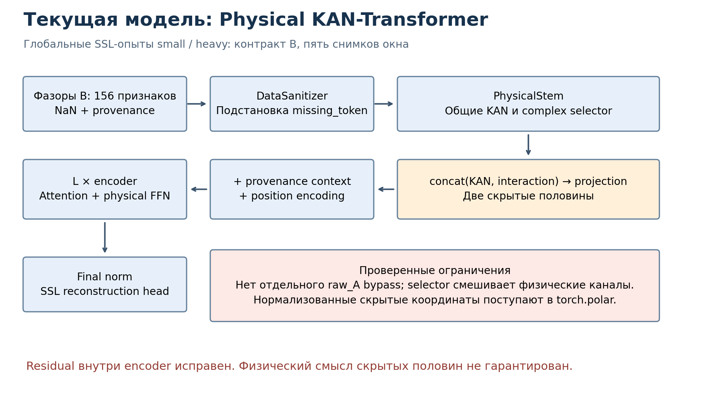
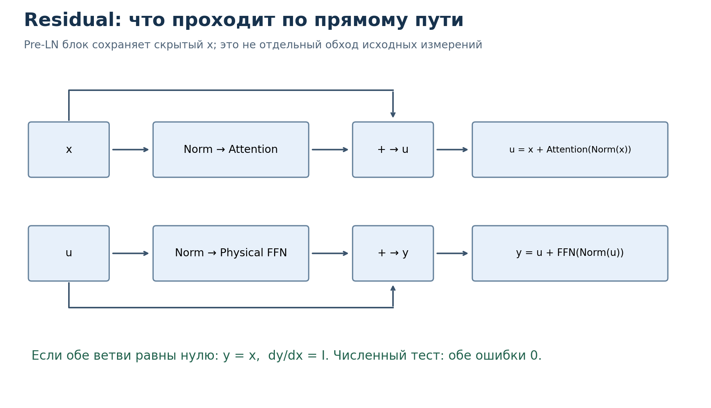
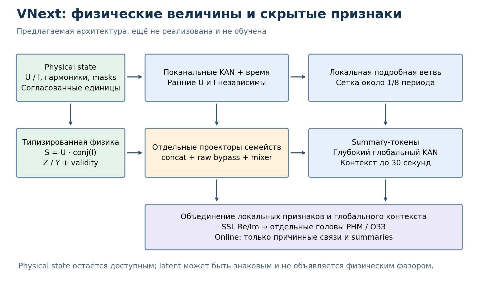

# Physical KAN-Transformer: текущая архитектура и следующая версия

> Продолжение 29.10.2026: автор согласовал комплексное внедрение идей в одну
> глубокую общую модель без предварительной широкой сетки исследований.
> Реализована отдельная PhasorHierarchicalKAN v1; актуальные устройство,
> ограничения и команды находятся в [runbook](PHASE_5_HIERARCHICAL_RUNBOOK.md).
> Текст ниже сохраняет первоначальный анализ и предложения, а не статус
> реализации после этого согласования. Диссертация по новой версии не меняется.

Дата: 28–29.10.2026. Статус: проверка действующего кода и предложение для обсуждения. Новая модель ниже **ещё не реализована и не обучена**. Старые модели, веса, входные контракты и данные не изменены. Обозначение `PhysicalKANTransformerVNext` рабочее: номер окончательной версии следует закрепить при реализации, отдельно от версии признаков.

## 1. Что действительно обучалось

Глобальное самоконтролируемое предобучение (SSL) и прикладной РНМ находятся в фазе 5. Класс модели вырос из фазы 4, поэтому её название осталось в docstring. Это не означает, что найденные глобальные опыты относятся к фазе 4.

Проверены код `osc_tools/ml/models/transformer.py`, `layers/transformer_blocks.py`, `phase5_ssl.py`, `spectral_features.py`, `lazy_multi_dataset.py`, `phase5_contracts.py`, оба сценария обучения в `scripts/phase5_experiments/`, конфигурации и журналы опытов. Авторские принципы сопоставлены с разделом `sec02_physkan_architectures.tex` главы 4: физические операции, KAN, направленное управление, прямой путь и обработка временного контекста. Текст диссертации не редактировался.

| Запуск | Признаки / время | Ширина / глубина / FFN | Что установлено |
|---|---|---|---|
| `pretrain_b_small` | B, 5 снимков | 64 / 4 / 256 | 200 записей эпох, лучший val loss 0.000357606 |
| `pretrain_b_heavy` | B, 5 снимков | 256 / 8 / 1024 | 200 записей эпох, лучший val loss 0.000301884 |
| `pdr_expert_snapshot_5_stride5_h123_deep24` | B_H123, 5 снимков | 128 / 24 / 512 | 100 записей эпох; прикладная глубокая ветвь уже существует |

Первые два числа взяты из `training_log.jsonl`, а не получены новым обучением. Улучшение SSL-loss само по себе не доказывает улучшение РНМ или ОЗЗ. Для small на синтетически созданном экземпляре с соответствующими размерами подсчитано 283 727 параметров; это подсчёт экземпляра, не аудит содержимого checkpoint.

**Важное различие веток.** Общий маршрут предусматривает SSL → прикладное дообучение. Но `h123_deep24` принудительно отключает SSL-инициализацию; экспертный опыт начинается с собственного weak-checkpoint. Поэтому нынешний 24-слойный РНМ нельзя описывать как результат дообучения найденного глобального backbone B. B_H123 содержит h1–h3 без низших компонент, всего 36 чисел на токен; B содержит 156.

**Фактическое время.** B = шесть симметричных составляющих × (9 стандартных + 4 низших компонент) × (модуль, угол). В глобальном загрузчике выбираются 10 периодов истории плюс 10 периодов модельного окна. При 50 Гц читается около 400 мс исходного сигнала, из которых примерно последние 200 мс представлены модельными токенами. `snapshot_5` сохраняет пять позиций. Режим `sequence_1_8` существует, но не был выбран в этих двух глобальных опытах. Точный счёт токенов определяется включёнными концами окон и округлением, а не всегда равен ровно 80.

## 2. Текущая архитектура по коду

### 2.1. Вход и Stem

Внешний тензор имеет форму `B × C × T`, пары чередуются: `[A1, φ1, A2, φ2, ...]`. Для контракта B `C=156`, то есть 78 комплексных пар. Здесь B в форме тензора означает размер батча, а B в имени контракта — вариант признаков.

`DataSanitizer` заменяет NaN нулём и добавляет обучаемый `missing_token`. Маска сохраняется. Это удобный способ сообщать о пропусках обычной сети, но обучаемая подстановка в позицию физического модуля сама может стать отрицательной. Кроме того, маска отдельных каналов пока не запрещает их участие внутри арифметики Stem. Нельзя считать отсутствующий ток измеренным нулевым током.

`PhysicalStem` выполняет следующие операции:

1. Выделяет амплитуды и углы, прибавляет обучаемый фазовый сдвиг.
2. Угловой `DirectionalRelayGate` модулирует амплитудную KAN-ветвь.
3. Параллельно строит комплексные числа из амплитуд и сдвинутых углов; `ComplexInteractionBlock` вычисляет произведения и отношения.
4. Соединяет `h_amp` и модули взаимодействий через concat, затем линейно проецирует в `d_model/2`.
5. Соединяет углы входов и взаимодействий; в Phase 5 применяет sin/cos, затем линейную проекцию в `d_model/2`.
6. Соединяет две половины в скрытый токен размерности `d_model`.

Таким образом, в Stem есть неарифметическая ветвь, но **отдельного неизменённого raw_A в concat нет**. KAN может отбросить часть исходной информации. Внешнее чередование пар также отличается от внутреннего формата `[вся amp-половина | вся angle-половина]`.

### 2.2. Что означают умножение и деление сейчас

Сначала общий обучаемый вещественный selector отдельно смешивает Re и Im всех входных комплексных пар. Из четырёх групп результата вычисляются `g1*g2` и `g3/g4`. Затем результаты конкатенируются. Знаменатель защищён снизу по квадрату модуля, а модуль отношения сжимается через tanh. По умолчанию Stem выдаёт 16 комплексных пар взаимодействий, FFN — 4.

Это **обучаемая комплексная арифметика**, но не гарантированные мощность и проводимость. Selector может смешать токи, напряжения и разные гармоники ещё до умножения. Умножение выполняется без сопряжения второго множителя. Физическая комплексная мощность при согласованной RMS-конвенции имеет вид `S = U * conj(I)`; просто `U*I` ей не равно. При амплитудной, а не RMS-конвенции необходим соответствующий коэффициент. `U/I` — импеданс, `I/U` — проводимость. Из произвольной смеси этих величин нельзя автоматически получить однозначную единицу измерения.

Нормировка в относительных единицах улучшает численную совместимость, но не делает ток и напряжение одним физическим типом. Нужно хранить базы Ubase, Ibase; тогда Sbase=Ubase·Ibase, Zbase=Ubase/Ibase, Ybase=Ibase/Ubase. Масштаб и происхождение измерения должны быть частью контракта.

### 2.3. Внимание, FFN и головы

После Stem прибавляются усреднённый по признакам provenance embedding и синусоидальное позиционное кодирование. Provenance сообщает состав measured/derived/missing, но такое усреднение теряет привязку статуса к конкретному каналу: полезно заменить его поканальным вводом в новой версии.

В `ComplexMultiheadAttention` Q, K, V имеют отдельные проекции для двух половин. Score складывает два скалярных произведения; одинаковые веса внимания агрегируют обе половины. Это не комплексное эрмитово внимание над физическими фазорами. Наличие двух половин не доказывает сохранение их физического смысла. В Phase 5 sin/cos улучшает периодичность входных углов, но линейная проекция этих функций — уже скрытый вектор, а не автоматически новый угол в радианах.

В каждом блоке:

`u = x + Attention(Norm1(x))`

`y = u + PhysicalFFN(Norm2(u))`.

FFN содержит два FastKAN для первой половины, угловой gate и комплексный interaction. Вклад interaction **складывается** с KAN-выходом после проекции, с коэффициентом `sigmoid(g)`, изначально примерно 0.119. Угловая половина FFN возвращает обучаемую дельту фазы. Затем внешний residual прибавляет обе дельты к скрытому состоянию.

После стека применяется final norm и соответствующая голова. SSL реконструирует признаки; прикладные головы решают свою задачу. KAN используется не «всюду»: QKV, выходные проекции и ряд других операций линейные. Это нормальная инженерная комбинация, и делать каждую матрицу KAN без проверки стоимости не требуется.

**Причинность:** encoder получает маску полностью отсутствующих токенов, но не causal mask. Для решения по последнему моменту уже доступного окна это допустимо. Для одновременной разметки всех внутренних моментов онлайн модель может видеть их будущее. Физически причинный FFT не превращает автоматически весь Transformer в причинный.

## 3. Отрицательные амплитуды: где именно ошибка

Отрицательное стандартизованное значение допустимо: `(A−mean)/std < 0` означает «амплитуда ниже среднего». Ошибка возникает, когда это число снова объявляют модулем комплексного числа и передают в `torch.polar`. Официальный контракт PyTorch определяет поведение для отрицательного `abs` как неопределённое: [torch.polar](https://docs.pytorch.org/docs/2.14/generated/torch.polar.html).

`AmpOnlyLayerNorm` центрирует первую половину. Кроме того, уже `proj_amp`, residual, позиционные добавки и обучаемые missing-токены не сохраняют положительность. Поэтому замена одной LayerNorm на RMSNorm сама по себе задачу не решает. Даже положительный масштаб RMSNorm не исправляет уже знаковый вход и последующие линейные операции.

Проведён воспроизводимый CPU-тест на PyTorch 2.7.1+cu118: положительные входные модули, случайные углы, seed=42, четыре слоя small. На входе physical FFN доли отрицательных координат составили 51.56%, 46.88%, 51.56%, 50.31%. Forward и градиенты в этом тесте конечны. **Конечность результата не отменяет нарушения контракта** и не доказывает корректность производной. Это синтетический тест, не статистика обученных весов и не доказательство непригодности старых результатов.

Варианты решения:

| Вариант | Что решает | Ограничение |
|---|---|---|
| ReLU/clamp | Убирает отрицательные значения | Создаёт массу в нуле и нулевой градиент на отрицательной стороне |
| abs | Даёт неотрицательный модуль | Складывает два разных знака, имеет излом в нуле; без фазового сдвига меняет комплексное число |
| softplus | Гладко параметризует положительный радиус | Не восстанавливает физический смысл произвольного latent; добавляет смещение, насыщается слева |
| `A*cosφ + j*A*sinφ` при знаковом A | Явная корректная арифметика знакового радиального коэффициента | Это другая параметризация, не физическая амплитуда; отрицательный A эквивалентен фазовому сдвигу π |
| Re/Im | Убирает требование положительного радиуса внутри арифметики | Произвольные смешанные Re/Im также не обязательно означают измеряемые U/I |
| Физический путь отдельно от latent | Сохраняет корректные входы физических операций | Требует отдельной версии архитектуры и явной схемы взаимодействий |

**Рекомендуемый основной путь — последний.** Физические модули сохранять неотрицательными, в относительных единицах; `log1p(A/a0)` можно подавать в обучаемую ветвь. Физические произведения вычислять по несжатым фазорам. Скрытые признаки могут иметь любой знак; их нормировать и складывать обычным образом, не называть амплитудами и не превращать обратно в фазоры без отдельного декодера.

На выходе SSL удобно предсказывать Re/Im, а модуль получать как `sqrt(Re²+Im²)`. Альтернатива — положительный радиус и периодическое направление. При почти нулевой амплитуде фаза неопределённа: не штрафовать её одинаково с фазой сильного сигнала. Комплексная ошибка уже естественно учитывает это свойство. Robust loss в проекте вычисляет Re/Im через sin/cos, поэтому нарушение контракта `torch.polar` в FFN и знак выхода loss — разные вопросы.

## 4. Поканальность и аналог depthwise separable

В лекции 5, PDF-страница 25, сначала выполняется отдельная пространственная свёртка каждого канала, затем pointwise 1×1 смешивает каналы. Это подход [MobileNets](https://arxiv.org/abs/1704.04861). Для нашей задачи переносится **порядок операций**, а не обязательно сама двумерная свёртка. Близкий пример для временных рядов — независимая обработка каналов общими весами в [PatchTST](https://arxiv.org/abs/2211.14730).

Сначала нужно определить, что является каналом. Для фазного контракта это IA, IB, IC, UA и т. д. Для B — I1, I2, I0, U1, U2, U0. Симметричные составляющие уже аналитически связывают три фазы, но не смешивают ток с напряжением. Гармоника — отдельная ось внутри канала, а пара A/φ — координаты одной компоненты. Произвольная скрытая координата Transformer каналом измерения не является.

Предлагаемая факторизация:

1. `X[B,T,C,H,2]` плюс masks/provenance → независимый encoder каждого физического канала. Ток и напряжение пока не взаимодействуют. Для одинаковых типов можно разделять веса, но вводить идентификатор канала и гармоники.
2. Короткое временное внимание или depthwise Conv1d внутри канала. KAN выполняет нелинейную обработку признаков данного канала. Частоты можно смешивать внутри него через управляемые веса с harmonic embedding.
3. Явные физические взаимодействия только по разрешённым рёбрам: U1–I1, U2–I2, U0–I0 или соответствующие фазные пары. Связи между гармониками сначала ограничить одинаковым номером.
4. Отдельные проекторы для семейств I, U, S, Z, Y. Затем concat их скрытых представлений, raw-feature bypass и обучаемый mixer. Это функциональный аналог pointwise стадии.
5. Временной иерархический backbone и прикладные головы.

Если просто поставить attention-mask после плотной проекции всех каналов, разделения уже не будет: смешение произошло до attention. Гарантия должна существовать в самом графе и в нормализации. Для ранних блоков нужен тест `∂h_I/∂U = 0`; после физического mixer ненулевой ответ разрешён.

Полный запрет межканальных связей тоже нежелателен: направление мощности принципиально зависит от соотношения U и I. Цель — сделать место и тип связи контролируемыми. Не обязательно создавать отдельный огромный Transformer для каждого канала: общие веса и объединение оси каналов с batch дают дешёвый старт.

### Физические ветви

Начать с `S=U·conj(I)`, ограниченного Z и Y для согласованных компонент. Для деления использовать, например, `U·conj(I)/(|I|²+ε²)` вместе с validity/confidence по уровню I. Это регуляризованная оценка, а не точный импеданс около нуля. ε задаётся в согласованных относительных единицах, с учётом измерительного шума. Не маскировать только результат: невалидный операнд должен закрывать соответствующую физическую ветвь.

S, Z и Y конкатенировать после **отдельных** преобразований масштаба. Сам concat ничего не складывает и не нарушает размерности. Смешивающая линейная проекция после него имеет смысл обучаемого латентного преобразования, а не закона сложения физических величин. Если требуется строгая размерностная интерпретация до самого выхода, сохранять типизированные ветви дольше.

Не начинать с всех возможных попарных произведений C²H²: это создаёт ненужные связи и вычислительную стоимость. Нужна малая таблица разрешённых физических операций. Если требуется обучаемый selector, ограничить каждый его вход одним физическим семейством и явно учитывать сопряжение.

## 5. Residual и смысл «1 + поправка»

Для одного блока `y=x+F(x)` производная равна `I+J_F(x)`. Здесь единица — тождественный оператор в производной, а не прибавление скаляра 1 к выходному сигналу. Во всём блоке с двумя ветвями Якобиан — произведение двух выражений этого вида. Для длинного стека единичный путь облегчает обучение, но не гарантирует отсутствие взрыва/затухания градиента.

Проверка `TransformerEncoderBlock`: attention и FFN заменены нулевыми модулями, dropout=0. Максимальная ошибка `output−input` равна 0, ошибка градиента относительно единицы равна 0. Следовательно, обход **внутри encoder исправен**. Это не проверка сохранения исходного спектра через Stem, final norm или task-head. Там тождественный путь отсутствует.

Для глубокой VNext предлагается `x + α_l F(Norm(x))`, где α_l — небольшой обучаемый коэффициент. Его начальное значение выбрать экспериментально, например 0.01–0.1. Это стартовая гипотеза, не гарантия стабильности. Нулевая α временно блокирует градиент в параметрах самой F, хотя α может учиться; небольшой ненулевой старт часто удобнее. Контролировать RMS ветви относительно skip и нормы градиентов по глубине.

Raw bypass нужен отдельно: `concat(encode_raw(X), learned_features, physical_features)`. Проекция raw-ветви уже может потерять информацию; если авторское требование — буквально неизменяемые исходные числа, хранить их отдельным доступным тензором и подключать в нужных слоях/голове. Не называть любую линейную ветвь гарантированным переносом исходного сигнала.

## 6. Предлагаемый общий каркас VNext

Два явно разных пространства:

- **Physical state:** измеренные/вычисленные фазоры, положительные модули, физические типы, реальные временные метки и masks. Не подвергается обычной LayerNorm, произвольному PE и смешению с missing embedding.
- **Latent state:** обычные знаковые признаки. KAN, нормализация, attention, residual и PE допустимы; физические единицы им не приписываются.

Физическую ветвь не обязательно выбрасывать после Stem. Её компактные типизированные признаки можно повторно вводить в каждый stage или каждые несколько блоков через concat и gate. Так сохраняется физическая направленность глубокого backbone без фиктивного `polar` над нормализованным latent. Вариант с полноценным обучаемым физическим состоянием на каждом слое интересен, но требует отдельного определения преобразований, положительности, фазовой эквивариантности и единиц.

Сначала реализовать короткую VNext на 200 мс, затем тот же контракт и головы использовать с длинной иерархией. Отдельные `architecture_id`, `feature_contract`, `time_contract`, `normalization_id`, режим causal/offline должны записываться в checkpoint. Новую версию нельзя получать загрузкой старых весов с `strict=False` без явного описания переноса и списка инициализированных заново модулей.

## 7. Глубина, ширина и compound scaling

В лекции 5, PDF-страница 26, обсуждается совместное масштабирование глубины, ширины и разрешения. [EfficientNet](https://arxiv.org/abs/1905.11946) демонстрирует этот принцип для CNN. Численные коэффициенты CNN нельзя непосредственно перенести в KAN-Transformer.

Для нас масштабируются как минимум L (глубина), d (ширина), T (временное разрешение/длина), H (число гармоник), G (число RBF-узлов KAN), r=d_ff/d и число физических групп. При фиксированном r плотный KAN-FFN имеет порядок стоимости `L·T·G·d²`; глобальное внимание — `L·T²·d`, а карты внимания занимают `B·heads·T²`. Константы, базовые linear-ветви и дополнительные RBF-активации существенны.

Если увеличить глубину в четыре раза и уменьшить ширину вдвое, член Ld² приблизительно сохранится. Но активации L·T·d вырастут примерно вдвое, а последовательная обработка большего числа слоёв может замедлиться. Поэтому «столько же параметров» не означает «столько же памяти и времени».

Глубина не гарантирует появление сложных физических сущностей. Они зависят от информации во входе, пути обмена, задачи и оптимизации. Из пяти снимков даже очень глубокая модель не восстановит наблюдённые между ними быстрые детали. Сначала стоит улучшить временной контракт и физическую корректность, затем исследовать глубину.

Минимальный набор кандидатов **для замеров**, не утверждённые оптимальные модели:

| Кандидат | d | L | d_ff | Назначение |
|---|---:|---:|---:|---|
| short-control | 64 | 4 | 256 | Сопоставление с small после изменения контракта |
| deep-narrow | 64 | 12 | 128 | Проверить полезность глубины при малой ширине |
| deep-balanced | 96 | 16 | 192 | Компромисс ёмкости |
| deep-24 | 128 | 24 | 256 | Более глубокий вариант после профилирования |

Для первых трёх начать с четырёх голов, для последнего — 4 или 8. Проверить делимость размерностей; для старого двухполовинного attention нужна также делимость d/2 на heads. G=5 оставить исходной точкой. Меньший FFN — гипотеза экономии, его выигрыш в качестве не заявляется.

## 8. От 200 мс до 30 секунд

При 50 Гц шаг 1/8 периода = 2.5 мс. Получаем приблизительно 80 токенов на 0.2 с, 400 на 1 с и 12 000 на 30 с. 30 секунд — это 150-кратное увеличение длины относительно 200 мс, а карта глобального внимания растёт примерно в 22 500 раз. Относительно пяти снимков разрыв ещё больше.

Одна FP32-карта `8 × 12000 × 12000` для одного примера занимает около **4.29 GiB**. Это только один тензор одного слоя: без softmax, градиентов, KAN, параметров и оптимизатора. В нынешнем `ComplexMultiheadAttention` карты материализуются явно. Накопление градиентов не помогает вместить один такой пример. 24 ГБ также не оправдывают наивный перенос многослойной модели на глобальное внимание всей длины.

В текущем SSL PE ограничено 256 позициями. Просто увеличить этот буфер недостаточно: нужно изменить стоимость внимания, collate, loss и временную семантику.

Предлагаемый длинный путь:

1. Сохранять локальные токены с сеткой около 1/8 периода для точных границ событий.
2. В каждом канале/локальном блоке применять окно внимания, например 64–128 токенов.
3. Из блоков длительностью 0.1–0.2 с получать компактные summary-токены. На 30 с это около 150–300 summaries.
4. Обрабатывать summaries глубоким глобальным стеком, возвращать контекст в локальную ветвь через cross-attention/gate.
5. Для плотного выхода сохранять skip высокочастотной временной ветви, чтобы pooling не уничтожил границы ОЗЗ и переключений.

При постоянном размере локального окна стоимость локальной части линейна по T. Глобальная часть квадратична по числу summaries, которое существенно меньше T. Это адаптация идеи иерархических окон [Swin](https://arxiv.org/abs/2103.14030), а не готовая гарантия времени работы нашей модели.

Для онлайн-режима summary блока доступен только после получения этого блока. Его нельзя подавать назад в более ранний момент, если summary видел будущее этого момента. Нужны causal attention, causal pooling или обновляемые prefix summaries и тест «изменение будущего не меняет прошлый выход». Offline-разметка может использовать двусторонний контекст; это отдельный режим.

### Частоты дискретизации, низшие компоненты и пропуски

Текущий `period_fraction_stride` округляет SPP/8 к целому числу отсчётов; это не интерполяция и не усреднение на строго единой временной сетке. Например, SPP=12 даёт шаг 2 отсчёта, то есть 1/6 периода. Для новой версии выбрать и закрепить: либо фактические timestamps и неравномерность относительно номинальной сетки, либо ресэмплинг на заданные моменты с согласованным фильтром. Входное PE должно учитывать секунды/периоды и реальный Δt, а не только номер токена.

10 периодов = 200 мс только при 50 Гц. При 60 Гц это 166.7 мс. Требование «не менее 200 мс» следует записать отдельно от требования числа периодов. Нижняя компонента на окне 10 периодов требует соответствующей предыстории, а на начале записи она недоступна.

В `SpectralFeatureBuilder` уже есть NaN/missing mask и опция `zero_unavailable_low_history`: численный ноль подставляется, но missing остаётся True. Именно такой смысл нужен. Нельзя обучать сеть считать недоступную низшую компоненту измеренным нулём. Raw NaN не должен попадать в attention/арифметику. Различать physical missing, derived, недостаток истории, SSL hidden и batch padding. Пропуски по Найквисту также не реконструировать как наблюдавшиеся цели. На самом Найквисте дискретный коэффициент особый, его фазу нельзя интерпретировать как обычный свободный фазор без отдельной оговорки.

## 9. Как обучать переменную длину без ручных меток

Нужен self-supervised masked modeling: целевые данные берутся из самой записи. Это не отсутствие критерия и не автоматическое обучение распознаванию аварии. Уже реализованный групповой masking 25% — полезная отправная точка. Идея реконструкции скрытых частей также используется в [MAE](https://arxiv.org/abs/2111.06377); переносить долю 75% из изображений без проверки не следует.

Предлагаемый sampler:

1. Split по исходным записям/семействам событий до нарезки. Дубликаты и соседние фрагменты одной аварии не должны попадать в разные split.
2. Выбрать источник: начальная смесь Open_EE : French/RTE = 2:1, как в текущем SSL.
3. Выбрать запись из расписания с контролем охвата. Затем длину из допустимых для неё bucket: 0.2, 0.5, 1, 2, 5, 10, 30 с. Длинная запись не обязана всегда подаваться целиком.
4. Выбрать начало равномерно среди допустимых позиций; добавить доступную левую историю для спектра. На истинном начале файла — masks, без искусственной «спокойной предаварии».
5. Часть примеров выбирать около физически обнаруженных изменений энергии/симметрии, сохраняя существенную долю равномерных фрагментов. Например, 70% равномерных и 30% около изменений — стартовая проверяемая гипотеза. Эти изменения не считать истинными аварийными метками.
6. Группировать батчи по длине и ограничивать их числом токенов; использовать padding-mask и маску loss. Не дополнять каждый короткий пример до 30 с.

Выбор записи до длины уменьшает перекос в сторону длинных файлов. Если сначала выбрать 30 с, а затем много раз отклонять короткие записи, состав источников и режимов незаметно изменится. Фактические пропорции логировать отдельно по числу окон, записям и секундам: 2:1 по окнам не равно 2:1 по наблюдённому времени.

Обучать сначала на коротких/средних окнах, затем добавлять длинные, оставляя короткие на всех этапах. Не начинать с исключительно 30-секундных входов: это дорого и слабо контролирует локальную точность. Валидация — фиксированный список записей, окон, длин и масок, отчёт по каждой длине и источнику.

### Какие маски полезны

Одиночный скрытый токен легко восстановить по почти идентичному соседнему скользящему FFT. Поэтому нужны временные непрерывные блоки, целые гармонические группы, физические каналы и небольшая доля локальных случайных масок. Длинные маски должны иногда перекрывать масштаб исходного спектрального окна, иначе задача сведётся к интерполяции.

Производные признаки считать **после маскирования** или скрывать все зависимости целевого признака. Нельзя скрыть I, оставив вычисленные из него Z и S, из которых I восстанавливается алгебраически. В текущем SSL группы строятся по физическому имени, а interaction вычисляется уже внутри Stem по замаскированному входу; новая расширенная физическая ветвь должна сохранить этот принцип.

Нужен отдельный mask-token/статус SSL-hidden. Нулевой сигнал, отсутствующий датчик и скрытая для обучения величина — три разных состояния. В текущем masking число заменяется нулём, а provenance остаётся исходным; новой версии полезно явно сообщать о скрытии.

Loss: robust Re/Im reconstruction на доступных скрытых элементах; отдельно контролировать h1, высшие и низшие компоненты, слабые токи, источники и переходы. При переменной длине решить, усредняем ли по токенам или сначала по записи: иначе длинные окна будут иметь другой статистический вес. Для малых компонент допустим нормированный вспомогательный loss с ограничением усиления шума. Абсолютную амплитуду нельзя уничтожать независимой нормировкой каждого окна — она нужна РЗА.

После SSL оценивать перенос: замороженный encoder + малая голова, затем ограниченное fine-tuning на РНМ/ОЗЗ. Сравнить с той же архитектурой без SSL. Меньшая ошибка реконструкции не гарантирует более раннего или более надёжного действия защиты.

## 10. Видеопамять и практическая скорость

`nvidia-smi` подтвердил **NVIDIA GeForce RTX 3060 Ti, 8192 MiB**. Измерений VNext нет; обещать, что 24 слоя и 30 с поместятся, пока нельзя. В новом профиле проверять forward, backward и optimizer step, а не только inference. Нужны peak allocated, peak reserved, общая занятость GPU, время шага и скорость подготовки данных.

Меры по порядку: ограниченное внимание → token-budget batching → микробатч 1–4 → accumulation → mixed precision в поддерживаемых ветвях → activation checkpointing. Комплексные операции нынешнего Stem/FFN принудительно FP32; AMP не уменьшит их память автоматически. FFT/спектр стоит кешировать только с версией контракта; иначе можно незаметно обучить на устаревших признаках.

Accumulation увеличивает эффективный batch, но не снижает память одного примера. При разной длине и разном числе валидных целей аккумулировать суммы loss и общий знаменатель, а не безусловно средние микробатчей: иначе короткие и длинные микробатчи получают неожиданный вес. Grad clipping выполнять после полного накопления, scheduler привязать к optimizer steps или наблюдённым токенам и сохранить эту конвенцию.

Лекция 6, PDF-страницы 28–30, напоминает о зависимости скорости от передачи памяти и реализации kernels. Depthwise и узкие KAN могут иметь меньше FLOPs, но быть медленнее на данной GPU. Поэтому параметров, размера checkpoint и теоретических FLOPs недостаточно для выбора.

## 11. Остановка и продолжение

Текущий SSL-сценарий сохраняет `latest_checkpoint.pt` через временный файл и replace, плюс `best_model.pt`; промежуточных снимков по шагам в этом цикле нет. Сохраняются модель, optimizer, scheduler, epoch, best loss, конфигурация и паспорт признаков. Resume проверяет часть контрактов. Однако RNG и положение внутри эпохи не сохраняются; обработчика безопасной остановки посередине эпохи нет. Accumulation и GradScaler в этом цикле также отсутствуют.

Итак, сейчас возможно продолжение с последней сохранённой эпохи, но не обещание точного продолжения с любой точки остановки. Отдельные PDR-сценарии имеют свою логику, их возможности нельзя приписывать SSL автоматически.

Для VNext сохранять только best/latest, но latest можно **перезаписывать** каждые N optimizer steps и при запросе остановки. Это не создаёт каталога тысяч checkpoint. Содержимое latest:

- модель, optimizer, scheduler, scaler, EMA (если используется);
- epoch, global optimizer step, число наблюдённых токенов, sampler cursor и расписание окон;
- RNG Python/NumPy/Torch CPU/CUDA и состояния отдельных генераторов;
- версии данных, split hash, архитектуры, входа, нормировки, masking и causal-режима;
- лучшая метрика и состояние незавершённого накопления либо гарантия сохранения только на границе optimizer step.

Рекомендуемый протокол остановки: запрос → завершение текущего optimizer step → атомарная запись latest → выход. При аварийном завершении можно потерять только шаги после последней записи. Для точного resume prefetch DataLoader не должен считаться уже обработанными данными; cursor означает последнюю потреблённую выборку. Проверка: короткая непрерывная траектория и такая же с save/load дают одинаковые следующие окна, loss, LR и параметры в пределах заранее заданной детерминированности.

Точную старую команду повторного длинного запуска сейчас не следует использовать как рекомендацию: она запускает legacy physical FFN с открытым POLAR-SIGN-01. После реализации новой версии подготовить отдельный runbook и проверенный smoke-resume. Финальный full_archive backbone допустим после выбора модели; включённые в его SSL данные затем уже нельзя называть полностью независимым тестом. Для публикационного сравнения сохранить research_strict.

## 12. Что переносить из лекций, а что требует осторожности

| Идея | Полезный перенос | Что не переносить автоматически |
|---|---|---|
| Depthwise + pointwise, лекция 5, PDF 25 | Сначала обработка внутри физического канала, затем явно разрешённые связи | Обычная плотная 1×1 сразу снова смешивает всё |
| Residual/pre-activation, PDF 18/22 | Identity-путь и отдельная нормируемая ветвь поправки | Не доказывает сохранения исходных измерений |
| Compound scaling, PDF 26 | Совместный бюджет L,d,T,H,G | Коэффициенты CNN и обещание оптимальности |
| Swin, лекция 6, PDF 13–14 | Локальные окна и глобальные summaries | Двусторонний контекст в онлайн-РЗА |
| ConvNeXt, PDF 18–24 | Контрольный временной depthwise stem и проверка рецепта обучения | Необходимость заменить физическую модель обычной CNN |
| Mobile MQA, PDF 27 | Возможное уменьшение K/V-проекций и кеша | Устранение T² только за счёт общих K/V |

Спектрально-временной вход удобно рисовать как изображение, но это не делает его обычной фотографией. Сдвиг по времени часто имеет смысл; перенос структуры с h1 на h7 не обязан сохранять физический смысл. Стандартные гармоники и lp-компоненты вообще не образуют равномерную частотную ось: нельзя ставить lp2 сразу после h9 как соседний пиксель и предполагать одинаковый локальный фильтр. Использовать известную частоту, номер гармоники, длительность окна и физический тип как metadata. Для дополнительной быстрой временной ветви можно исследовать сырые сигналы; она требует отдельного контроля масштаба и стоимости.

Два дополнительных понятия:

**Инвариантность и эквивариантность.** При общем повороте U и I на один угол величина U·conj(I) не меняется, а сам фазор поворачивается. Нужно заранее решить, какие признаки должны меняться, какие оставаться постоянными. Независимый случайный поворот каждой фазы разрушит физические соотношения. Для временного сдвига фазовый поворот зависит от частоты гармоники.

**Физическая структура и интерпретируемость.** Наличие KAN или умножителя не делает каждый скрытый нейрон физической величиной и не даёт автоматически закон электротехники. Интерпретируемость проверяется управляемыми воздействиями, единицами, зависимостями, устойчивостью по источникам и извлечением функций; красивое имя слоя не заменяет эту проверку.

## 13. Предлагаемая вставка в план и критерии перехода

Разумно сейчас принять в качестве основы: отдельную версию, разделение physical/latent, поканальную раннюю обработку, типизированные взаимодействия, явный raw bypass, корректные masks и надёжное resume. Конкретная глубина, число summaries, доли sampling и выигрыш качества остаются исследовательскими гипотезами.

| Этап | Результат | Проверка перед переходом |
|---|---|---|
| A. Контракты | Physical/latent, U/I/IN/UN, шкалы, masks, время | Measured/derived/missing; online/precomputed; коэффициент 3 и полярности |
| B. Короткая VNext | 200 мс, typed stem, raw bypass, residual, KAN | Нет отрицательного polar; конечные градиенты; независимость ранних каналов; фаза ±π; нулевые знаменатели |
| C. Сравнение | Legacy и новая версия на одном split | Отдельно численная корректность, затем группировка и физические ветви; не менять всё в одном доказательном сравнении |
| D. Длинный путь | 0.2–30 с, локальные окна, summaries | Padding-инвариантность; длина 30 с; peak VRAM; causal-тест для online |
| E. Trainer | Buckets, accumulation, AMP/checkpointing, resume | Непрерывный run против прерванного; полное содержимое checkpoint; аварийная запись |
| F. SSL pilot | Несколько глубин на фиксированном бюджете | Метрики по длинам/источникам, coverage, downstream probe, скорость |
| G. Длительное обучение | Выбранная модель, best/latest | Зафиксированы контракт и конфигурация; длительный run запускается после обсуждения |

При сравнении менять один согласованный фактор: сначала исправление пространства физической арифметики, затем ранняя поканальность, затем глубина, затем длинный контекст. Более дешёвую модель без повторных физических injection оставить контролем. Все комбинации L×d×H×G перебирать не требуется.

## 14. Проверки и воспроизводимость этой записки

Выполнены чтение кода/конфигов/журналов, просмотр архитектурного раздела главы 4, извлечение текста обеих лекций, визуальный просмотр страниц depthwise и shifted windows, сверка первичных публикаций. GPU проверена `nvidia-smi`. Остаточная цепочка и нарушение знакового контракта проверены на синтетическом экземпляре.

Скрипт: `scripts/phase5_experiments/audit_architecture_contracts.py`. Результат: `reports/phase5/architecture_contract_audit_20261028.json`. Запуск в найденном окружении: `C:/ProgramData/anaconda3/python.exe scripts/phase5_experiments/audit_architecture_contracts.py`. Он не читает пользовательские checkpoint и не обучает модель.

Дополнительно выполнены существующие `tests/unit/test_transformer_model.py` и `tests/unit/test_phase5_ssl.py`: **85 passed**. Автозагрузка сторонних pytest-плагинов отключена через `PYTEST_DISABLE_PLUGIN_AUTOLOAD=1`, поскольку установленный nbval не стартует из-за отсутствующего attrs; зависимости окружения не менялись. Эти тесты не проверяют все физические инварианты и не закрывают POLAR-SIGN-01. Три новые PNG-схемы просмотрены; ссылки на рисунки и `git diff --check` проверены.

Не выполнены: обучение VNext, оценка качества новых архитектур, замер их VRAM, проверка всех старых checkpoint или независимая ревизия всего датасета. Эти результаты не заявляются. Данная записка и новые схемы описывают проверенную текущую реализацию и конкретный проект следующей версии; они не заменяют исторические описания прежних опытов.
