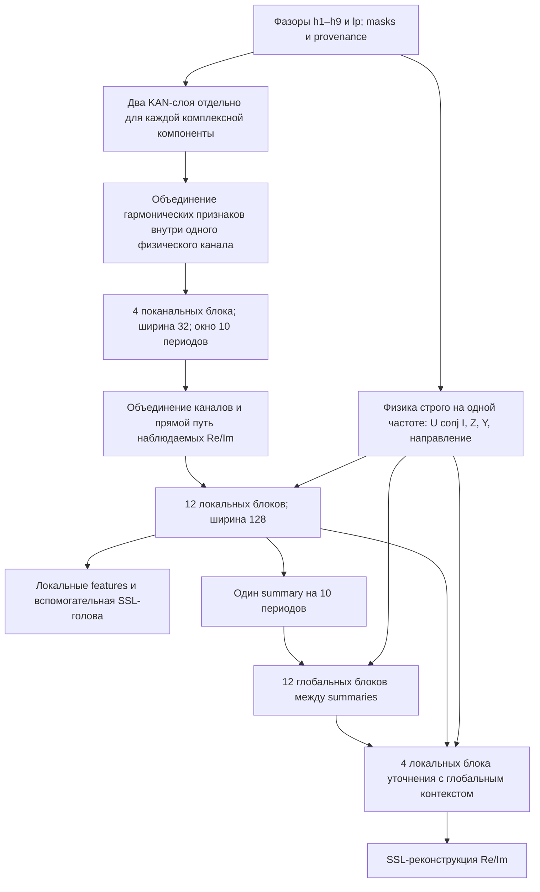

# Фаза 5: глубокая PhasorHierarchicalKAN v1

29.10.2026. Отдельная новая модель по согласованным пожеланиям автора.
Она не заменяет PhysicalKANTransformer и прежние checkpoint. Диссертация
и её результаты не меняются. Новые результаты нельзя приписывать прежним опытам.

**Текущий статус (29.10.2026, после второй оптимизации):** рабочее обучение
остановлено по просьбе пользователя, checkpoint: эпоха 9, cursor=11932,
step=63367. Автоматического возобновления нет. Следующий запуск — вручную
из прежнего F5-файла с RESUME=True. Актуальные режим упаковки и защита от OOM
описаны в разделе «Упаковка окон и защита памяти» в конце этого документа.
Более ранние замеры и сообщение о фоновом продолжении ниже — история работы.

## Что собрано

Полный спектральный состав B: h1–h9 и lp2/lp4/lp6/lp10 для
I1/I2/I0/U1/U2/U0. На токен приходится 78 комплексных компонент, 156 чисел.
Внутренний численный формат — Re/Im; исходная нормировка подготовленных
Open_EE и French/RTE сохранена. Никакой повторной нормировки каждого окна.

Модель содержит **32 residual-блока внимания с KAN**, ширина основного
представления 128, четыре головы, FFN 256, пять RBF-узлов. Всего
**14 711 014 параметров**. Это глубокая общая модель, а не урезанная РНМ.



32 блока — суммарная глубина пути «поканальный → локальный → глобальный →
уточнение», а не 32 одинаковых слоя на полной сетке. Дополнительно есть два
покомпонентных KAN-слоя во входе. У РНМ доступен отдельный локальный выход
после 4+12 блоков. Прикладная обученная голова РНМ для этой версии ещё не
создана; сейчас готово общее SSL-предобучение и интерфейс локальных features.

### Физические цепочки и уровни смешения

Физическое состояние хранится отдельно от latent. LayerNorm, позиционные
прибавки и residual работают только со скрытыми векторами. `torch.polar`
над знаковыми latent отсутствует. На вход физической арифметики попадают
только наблюдаемые фазоры. SSL-hidden и missing закрывают соответствующие
операнды до умножения/деления, поэтому производные не раскрывают скрытую цель.

В первых двух KAN-слоях нет ни межканального, ни межчастотного смешения.
После них обучаемые **скрытые** признаки гармоник объединяются внутри
каждого канала. Четыре блока временного внимания по-прежнему независимы
для I1/I2/I0/U1/U2/U0. Далее разрешён совместный latent-анализ.
**Явного умножения/деления разных частот нет ни на какой глубине**.
Это консервативный вариант принятого ограничения; добавлять такие операции
для глубинных скрытых координат без физического определения не требуется.

В каждом локальном, глобальном и уточняющем блоке повторно вводятся
векторные физические признаки. Используются согласованные пары U1–I1,
U2–I2, U0–I0 на одной частоте, Re/Im произведения с сопряжением,
модуль, единичное направление, регуляризованные Z/Y и обучаемый угол
максимальной чувствительности. Направленная цепочка имеет вид
`tanh(3*(cos(phi)*cos(MTA)+sin(phi)*sin(MTA)))`, взвешенный модулем.
Таким образом, направление не исчезает после входного блока.

`S = U*conj(I)/2` соответствует принятой в спектральном builder конвенции
амплитудных фазоров. Для симметричных компонент это **покомпонентный признак**,
а не полная трёхфазная мощность: для суммарной мощности нужен коэффициент 3
и сумма компонент. Действуют масштабы подготовленных источников с их reserve;
числа не объявляются ваттами/омами без восстановления этих масштабов.
Для Z/Y заданы шумовые пороги в подготовленных единицах. При невалидном
знаменателе соответствующая ветвь закрывается. Производные сжимаются
signed-log1p; направления остаются векторными.

В global-блоках используются агрегаты физических признаков локального окна.
Это описатели окна, а не «фазор мощности всей записи». Исходные покомпонентные
векторы остаются доступны уточняющей локальной ветви.

## Временная организация

Основная единица — **10 периодов**, не безусловно 200 мс.
При 50 Гц это 200 мс, при 60 Гц — около 166.7 мс. В блоке 80 токенов.
При 50 Гц 30 секунд дают 150 блоков и 12 000 подробных токенов;
глобальное внимание работает только по 150 summaries.

Сетка строится округлением **каждой абсолютной позиции** `n*SPP/8`,
а не повторением одного округлённого шага. Например, при SPP=12 чередуются
шаги 1 и 2 отсчёта: накопления ошибки времени больше нет. В модель передаются
фактические timestamps в периодах. Это дискретная сетка исходных данных,
не интерполяция фаз и не выдуманные отсчёты.

Для нецелого `f_adc/f_network` новый Fourier builder использует фактическую
частоту в экспоненте; только длина наблюдаемого окна округляется до целого
числа сырых отсчётов. Сохраняются относительные углы B и единый фазовый
reference внутри каждого частотного блока. Компонента ровно на Найквисте
теперь считается недоступной для свободного комплексного фазора.
Старый builder не изменён. При SPP<8 запись пропускается с учётом попыток в логе.

Низшие компоненты без достаточной истории **внутри данного блока** получают
missing, а не измеренный ноль. Строгая изоляция локального РНМ относится также
к Fourier: он не читает сырые отсчёты до начала своего 10-периодного блока.
Поэтому в начале каждого блока есть спектральный разогрев; lp10 становится
доступной лишь у его конца. Это намеренное ограничение, иначе внешняя история
незаметно попала бы в локальный РНМ через спектр даже без global attention.
Глобальная сеть связывает блоки отдельным явным путём. Для локального РНМ
подавать скользящее окно, заканчивающееся текущим моментом, и брать последний
выход. Никакого предположения о спокойной предаварии в начале файла нет.

**Глобальный SSL сейчас offline, двусторонний.** Он годится для анализа уже
наблюдённой записи. `local_only=True` не читает другие 10-периодные блоки,
что проверено тестом. Внутри локального блока внимание двустороннее: для
текущего решения РНМ нужно подавать окно, заканчивающееся текущим моментом.
Не использовать внутренние выходы полного offline-окна как онлайн-решения
ранних моментов. Потоковый causal-cache пока не реализован и не заявляется.

## Маски, ошибка и аугментации

Перепроверены `phase5_ssl.py`, `ssl_dataset.py`, `losses.py`, `augmentation.py`.
Используется существующий `apply_group_mask` с долей 25% физических групп.
К нему добавлен один непрерывный временной участок 8–24 токена на каждый
10-периодный блок. Поэтому общая доля скрытия больше 25% и зависит от пересечений;
она видна через число targets. Истинно отсутствующие компоненты не становятся
целями. Состояния разделены: missing=0, measured=1, derived=2, SSL-hidden=3;
padding задаётся отдельной временной маской.

Ошибка сохраняет векторный смысл: берётся евклидова длина разности Re/Im,
затем радиальная Huber с beta=0.1. В отличие от суммы двух покоординатных
Huber прежнего Phase 5, эта версия инвариантна к общему повороту координат.
Итог `global_loss + 0.25*local_loss` позволяет учить полезный локальный выход
без зависимости от соседних блоков. При accumulation складываются суммы и
число действительных целей; длинные микробатчи не получают случайного веса
из-за усреднения средних.

Повторно используется `TimeSeriesAugmenter` для общей инверсии и масштабирования
I/U с прежними умеренными диапазонами. Синхронный циклический сдвиг фаз
выполняется вместе с перестановкой provenance. RNG аугментаций определяется
номером примера, не состоянием dropout модели. Произвольные независимые
повороты фаз, перестановки I отдельно от U и дополнительный шум не добавлены.

## Выборка и длительность обучения

Источники — существующий registry, схема `research_strict`, смесь Open_EE :
French/RTE = 2:1 по расписанию окон. Внутри каждого источника используется
циклический переставленный проход по split, затем случайные длина и начало.
Так запись не теряется навсегда за равномерным случайным выбором с возвращением.
Отбраковки коротких/непригодных записей могут изменить фактическую пропорцию;
source, record, serial, attempt и длина каждого окна записываются в журнал.

Длины: 1/2/5/10/25/50/150 блоков, только доступные в выбранной записи и
не превышающие 30 с. В первой эпохе максимум 5 блоков, во второй 25,
далее все длины. Короткие примеры остаются на всех этапах. Fixed validation
с первого раза содержит доступные длины до установленного максимума.
64 окна validation — экономный контроль обучения, а не итоговая научная оценка.
Для неё позже понадобится расширенный независимый контроль.

Накопление идёт до 640 действительных временных токенов или конца эпохи.
Порядок окон сохраняется: окно, пересекающее порог, целиком входит в этот шаг.
Внутри шага теперь упаковываются до восьми независимых окон за проход GPU;
padding ограничен бюджетом. Очень длинные окна обрабатываются отдельно с
пересчётом активаций. Batch-эффект длинного окна и набора коротких различается;
состав шага, число проходов и объём padding записываются в журнал.

По умолчанию 20 000 окон/эпоха и 200 эпох. Это **верхний план**, обучение
можно останавливать и продолжать. Расписание LR привязано к optimizer step,
warmup 200 шагов, далее cosine restarts с периодом 4000 шагов и нижним
множителем 0.05; AdamW, LR=2e-4, weight_decay=1e-4, clip_grad_norm=1.
Значения зафиксированы как одна рабочая конфигурация, широкого перебора нет.
Скорость полного датасета не следует оценивать по одному синтетическому шагу:
чтение shards и Fourier могут быть существенной частью времени.

## Основной запуск из IDE: прежний файл и константы

Открыть **`scripts/phase5_experiments/run_phase5_pretrain.py`**, найти
`run_manual()` внизу файла и запустить сам файл кнопкой Run/F5 **без аргументов**.
Интерпретатор рабочего окружения: `C:\ProgramData\anaconda3\python.exe`.
Рабочая папка может быть любой: пути вычисляются от корня проекта.
CLI остаётся дополнительным способом, ноутбук не нужен.

Для продолжения ночного опыта уже выставлены:

```python
MODEL_FAMILY = "hierarchical"  # глубокая общая модель; "legacy" — прежние SSL-модели
RESUME = True
SMOKE = False
EPOCHS = 200                  # общий предел, не ещё 200 эпох
SAMPLES_PER_EPOCH = 20_000
VALIDATION_SAMPLES = 64       # для hierarchical
TARGET_TOKENS = 640           # прежний эффективный батч
MAX_WINDOWS_PER_FORWARD = 8  # до восьми окон одним проходом
MAX_PADDED_TOKENS = 4000
NO_CHECKPOINT_MAX_TOKENS = 4000
GPU_RESERVE_MIB = 1024
NUM_WORKERS = 2
MAX_SECONDS = 30.0
SAVE_EVERY_STEPS = 10
CONSOLE_INTERVAL_SECONDS = 2.0
```

`MODEL_PRESET`, `BATCH_SIZE`, `TEMPORAL_MODE`, `SCHEDULER_TYPE` находятся
в отдельной ветке legacy. Для новой модели численные параметры при продолжении
оставить прежними; изменять EPOCHS, NUM_WORKERS и частоту вывода/сохранения можно.
Чтобы начать новый опыт, задать другой `HIERARCHICAL_OUTPUT` и `RESUME=False`.
Для проверки `SMOKE=True` также задать `RESUME=False`; используется отдельный
каталог `hierarchical_manual_smoke`, рабочий ночной опыт не затрагивается.

В терминале будет одна обновляемая строка: эпоха, полоса прогресса, процент,
число окон, сглаженный loss, LR, норма градиента, optimizer step, скорость и ETA.
В Output-панели, которая не поддерживает обновление строк, вывод ограничен
одной строкой примерно в 30 секунд. Validation имеет свою полосу и краткий
итог по Open_EE/French с отметкой нового лучшего результата. Подробный JSON
записывается только в `training_log.jsonl`, не печатается на каждом шаге.

После каждой эпохи обновляются `training_curves.png` и `training_summary.json`.
`progress.json` хранит читаемый программами текущий статус для будущей панели
запуска. Обычные исключения не скрываются: traceback остаётся видимым в IDE.
CUDA OOM обрабатывается отдельно: повтор меньшими частями или безопасная
остановка с корректным checkpoint, как описано ниже.

**Остановка:** Ctrl+C в терминале с обучением или файл STOP, описанный ниже.
Красная кнопка принудительного завершения процесса в IDE не равнозначна
Ctrl+C и может оборвать запись/накопление; тогда продолжение идёт с предыдущего
атомарно сохранённого latest. Самодельного графического приложения пока нет.

## Дополнительный запуск в PowerShell

Рабочая папка:

```powershell
Set-Location 'D:\Программирование\Fork\Scientific_research_osc_ML'
```

Новый длительный запуск с отдельным каталогом результатов:

```powershell
& 'C:\ProgramData\anaconda3\python.exe' -X utf8 scripts/phase5_experiments/run_phase5_hierarchical.py
```

По умолчанию используется `experiments/phase5/phasor_hierarchical_v1`.
Непустой каталог без `--resume` отвергается, прежние результаты не архивируются
и не перезаписываются автоматически. Все подготовленные данные берутся из
существующих registry/split, дополнительной выгрузки не требуется.

Остановить: **один раз Ctrl+C**, дождаться сообщения `Saved ... latest_checkpoint.pt`.
Обработчик завершает текущую группу накопления и optimizer step, сохраняет состояние.
Группа не укорачивается из-за остановки, чтобы не менять траекторию обучения.
Ожидание при чтении/создании workers возможно. Альтернатива из другого терминала:

```powershell
New-Item -ItemType File -Path 'experiments/phase5/phasor_hierarchical_v1/STOP'
```

Перед продолжением удалить только этот файл, если он создавался:

```powershell
Remove-Item -LiteralPath 'experiments/phase5/phasor_hierarchical_v1/STOP'
```

Продолжение:

```powershell
& 'C:\ProgramData\anaconda3\python.exe' -X utf8 scripts/phase5_experiments/run_phase5_hierarchical.py --resume
```

При необходимости увеличить общий предел эпох:

```powershell
& 'C:\ProgramData\anaconda3\python.exe' -X utf8 scripts/phase5_experiments/run_phase5_hierarchical.py --resume --epochs 400
```

Не менять при resume длины, loss, архитектуру, split, нормировку, seed,
число окон/эпоху или target-tokens: это другой опыт. Контракт проверяет хеш
модели и подготовки данных, версию численного алгоритма обучения и настройки.
Изменение только консольного оформления/ручных констант больше не блокирует
загрузку весов. Для исходного ночного checkpoint разрешена адресная проверенная
миграция с известного SHA-256; неизвестные старые версии не пропускаются.
Миграция проверена сравнением непрерывного старого цикла со старым checkpoint,
продолженным новым циклом: веса, лучшая validation, прогресс и Torch RNG совпали
точно. Рабочие ночные веса при проверке не перезаписывались. После интерфейсной
доработки прошли **107 unit/regression-тестов**.
`--workers 0` разрешён для диагностики чтения, не меняет выборку.

Повторная проверка потребления GPU без датасета:

```powershell
& 'C:\ProgramData\anaconda3\python.exe' -X utf8 scripts/phase5_experiments/run_phase5_hierarchical.py --profile
```

## Что сохраняется

`latest_checkpoint.pt` атомарно перезаписывается каждые 10 optimizer steps,
при безопасной остановке и на границе эпохи. `best_model.pt` обновляется
после улучшения фиксированной validation. До первой validation best ещё нет.
Хранятся веса, optimizer/scheduler/scaler, RNG Python/NumPy/Torch CPU/CUDA,
epoch, consumed cursor, optimizer step, best и весь контракт.
Снимок всегда на границе optimizer step, незавершённых градиентов в нём нет.
Prefetch не сдвигает сохранённый cursor. При аварийном выключении теряются
шаги после последнего latest, а не гарантированно ноль шагов.

Сохраняются также `config.json` и подробный `training_log.jsonl`, с validation
по источникам и числу блоков. Журнал append-only; при аварии между записью
журнала и checkpoint в нём могут остаться строки шагов, повторённых после
resume. Источник истины для прогресса — checkpoint; для графика такие строки
нужно дедуплицировать по `(epoch,cursor,step)`, оставляя последнюю.

Новый backbone не совместим по весам со старым PhysicalKANTransformer.
`strict=False` для незаметного переноса не используется. Старые скрипты,
датасеты, модели и checkpoint не изменялись при добавлении этой архитектуры.
29.10.2026 прежняя F5-точка входа дополнена выбором семейства; legacy CLI сохранён.

## Ночной запуск и проверка добавленного, 29.10.2026

Остановлен штатно после трёх полных эпох: `epoch=3`, `cursor=168`, `step=20771`.
Лучший checkpoint относится к окончанию второй эпохи (`step=13091`).

| Завершённая эпоха | Validation, общий | Open_EE | French/RTE |
|---|---:|---:|---:|
| 1 | 0.00239944 | 0.00179779 | 0.00353949 |
| 2 | 0.00123699 | 0.00071063 | 0.00223440 |
| 3 | 0.00230306 | 0.00196674 | 0.00294035 |

Это не монотонное улучшение. Расписание LR имеет рестарты каждые 4000 шагов,
а эпохи содержали 5382/7709/7623 шага, поэтому несколько подъёмов LR за эпоху
ожидаемы. Одновременно меняется распределение длин по curriculum. Это возможные
объяснения колебаний, не доказанная причина ухудшения; для вывода о переобучении
трёх точек мало. Алгоритм и LR в этой редакции **не менялись**.

Read-only проверка на тех же 64 validation-окнах: глобальная ошибка лучшего
checkpoint 0.00096385, локальная 0.00109258; постоянное предсказание нулевого
вектора даёт 0.00351029. Значит, модель уже лучше тривиального нулевого выхода
по этому критерию (глобальная ошибка ниже примерно на 72.5%). Это не accuracy
распознавания аварий. Общая logged loss = global + 0.25*local.
У latest глобальная ошибка 0.00134196: он уступает best, но тоже лучше нуля.
Числа и обе ветви сохранены в `experiments/phase5/phasor_hierarchical_v1/night_review.json`.

Преимущество global-head над local-head не является чистой абляцией пользы
дальнего контекста: головы имеют разные пути и веса. Старые SSL-loss также
несопоставимы напрямую из-за другой ошибки, масок и временного контракта.
В fixed validation пока нет окон 10/30 с, максимум 25 блоков (5 с при 50 Гц).
В train за ночной фрагмент встретилось только девять окон по 150 блоков:
качество именно 30-секундного контекста пока не подтверждено.

Аудит состава: отдельные model/data/trainer нужны для сохранения legacy;
диагностические скрипты оставлены воспроизводимыми проверками, не точками
ежедневного запуска. Исторический архитектурный разбор и этот runbook имеют
разные назначения; новый документ для IDE не создавался. Исправлены лишняя
пользовательская точка входа, шумный вывод и зависимость resume от оформления
всего trainer-файла. GUI пока внесён задачей в общий план фазы 5.

## Проверки

RTX 3060 Ti, 8192 MiB, PyTorch 2.7.1+cu118, BF16 и activation checkpointing.
Полный forward/backward/AdamW step на 12 000 токенах:
peak allocated **1797 MiB**, peak reserved **2096 MiB**, конечные градиенты.
Это синтетический профиль микробатча 1, а не точная оценка всех рабочих
процессов GPU и не обещание скорости загрузки данных. Замер:
`reports/phase5/hierarchical_v1_profile.json`.

Проверяются независимость ранних каналов, отсутствие межчастотной физической
арифметики, знак направления мощности, отсутствие утечки скрытых операндов,
локальность РНМ-выхода, доступ глобального выхода к другим блокам,
padding-инвариантность, конечные градиенты, вращательная инвариантность
векторной ошибки и физического S/Z/Y, сетка при SPP=12, Fourier при SPP=31.3.
Отдельный интеграционный сценарий `check_hierarchical_resume.py` сравнивает
непрерывное обучение с save/load на реальных Open_EE и French/RTE при workers=2
и накоплении по 240 токенов (шесть окон, разные длины);
результат сохраняется в `reports/phase5/hierarchical_v1_resume_check.json`.
После успешной проверки временные дубли весов удаляются, журналы и отчёт остаются.
Набор unit/regression-проверок новой модели, прежнего Transformer, SSL и спектра:
**104 passed** с `PYTEST_DISABLE_PLUGIN_AUTOLOAD=1` (обход стороннего nbval/attrs,
зависимости окружения не изменены).

Измеренная работоспособность не является доказательством качества новой сети.
Длительный основной запуск автоматически не оставлен работающим: приведённая
выше команда запускает его в вашем терминале, где доступны журнал и Ctrl+C.

## Раздельные настройки и дообучение ОЗЗ (29.10.2026)

В `run_phase5_pretrain.py::run_manual()` сначала выбирается `MODEL_FAMILY`,
затем редактируется только соответствующая ветка. У `hierarchical` нет
`TEMPORAL_MODE`, `MODEL_PRESET`, `BATCH_SIZE` или legacy scheduler. Её вход —
B/ReIm, шаг 1/8 периода, локальный блок 10 периодов, переменное число блоков.
Настройки и численный контракт продолжающегося SSL не изменены.

### Ручной запуск ОЗЗ из IDE

1. Открыть существующий `scripts/phase4_experiments/sim_ozz/run_phase4_finetune_sim_ozz.py`.
   В `run_manual()` выбрать `MODEL_FAMILY="hierarchical"`. Сама новая ветка,
   данные и результаты относятся к фазе 5; расположение привычной точки входа сохранено.
2. Использовать интерпретатор `C:/ProgramData/anaconda3/python.exe`, запуск файла
   Run/F5 **без аргументов**. Рабочая папка IDE несущественна: основные пути абсолютные.
3. `SSL_CHECKPOINT` по умолчанию указывает на
   `experiments/phase5/phasor_hierarchical_v1/best_model.pt`. После следующих дней
   SSL это будет актуальный best по проверочной ошибке. Переносятся веса backbone;
   новая голова имеет четыре выхода Stable/Petersen/PetersSlepian/Beliakov.
   Все четыре выключены — «не ОЗЗ», отдельного пятого logit нет.
4. Для предварительной проверки поставить `SMOKE=True, RESUME=False` и запустить.
   Это 10 учебных и 10 проверочных окон в отдельном каталоге
   `experiments/phase5/hierarchical_ozz_smoke`. Повторный старт в непустой каталог
   с RESUME=False запрещён; для повторения задать новый каталог в smoke-ветке.
5. Для обучения поставить `SMOKE=False, RESUME=False`. Результаты:
   `experiments/phase5/hierarchical_ozz_v1`. Разумный начальный рецепт уже задан:
   100 эпох, 2000 окон/эпоху, 200 фиксированных проверочных окон, микробатч 1,
   накопление 640 токенов; LR backbone=1e-5, новой головы=1e-4. Здесь постоянные LR,
   без унаследованных из legacy рестартов. EPOCHS — общее число эпох.
6. Продолжение **этого ОЗЗ-опыта**: `RESUME=True`, тот же OUTPUT_DIR, остальные
   численные настройки прежние. Восстанавливаются голова, backbone, AdamW, RNG,
   эпоха и позиция внутри эпохи. SSL checkpoint при таком продолжении уже не нужен.
   Изменить можно EPOCHS, число workers, частоту сохранения/вывода.
7. Остановить с сохранением: Ctrl+C в терминале либо создать пустой файл `STOP`
   внутри OUTPUT_DIR. Завершается текущее накопление. Перед продолжением удалить STOP.
   Кнопка IDE «убить процесс» не гарантирует последнего сохранения. Перед запуском
   ОЗЗ на одной GPU завершить/приостановить SSL, чтобы не конкурировать за ресурсы.

Прогресс: окна, скорость, ETA, сглаженная BCE, LR backbone, градиент и шаг;
после эпохи — validation BCE, macro F1, F1 четырёх классов и доля ложных
срабатываний на реальных «не ОЗЗ». Полные precision/recall/specificity по классам
сохраняются в `training_log.jsonl`; статус — `progress.json`, графики —
`training_curves.png`. В терминале обновляется строка, в обычной панели вывода IDE
печатается строка примерно раз в 30 секунд. Traceback ошибок не скрывается.
`best_model.pt` выбирается по минимальной validation BCE; `latest_checkpoint.pt`
нужен для продолжения. Числа BCE/F1 нельзя сравнивать с SSL vector-Huber loss.

### Данные и границы интерпретации

- RTDS читает исходные CSV через существующий `load_raw_csv`, включая нормировку
  SIM_NOMINAL, реальные dt и четыре разметки фаз процесса. Разбиение по файлам
  и типам дуги переиспользует `stratified_sim_ozz_split` с seed=42.
- С 31.10.2026 реальные «не ОЗЗ» берутся из всего неразмеченного Open_EE:
  все 44 773 записи из 18 CSV присутствуют в подготовленных shards.
  Имена, содержащие любой идентификатор экспертного отчёта v1.7, исключаются
  целиком (включая «+», «−», все шины и события). Остальные считаются фоном
  по принятому пользователем правилу; ML_2_* и малый labeled CSV не используются.
  Это эвристические отрицательные метки, а не подтверждение отсутствия ОЗЗ экспертом.
- После исключения 3637 записей: 35 021 train, 1672 validation, 4392 SSL holdout
  сохранены отдельно; 51 запись не проходит длину/дискретизацию.
  Все шины одного исходного имени остаются в одном split; записи SSL train
  не переводятся в validation. Нормировка, частоты 50/60 Гц, реальная частота
  дискретизации, пропуски и provenance читаются из того же источника, что SSL.
  В `split.json` сохраняются состав выборки, исключения и SHA256 источников.
- Сэмплирование поровну по четырём группам RTDS и реальным «не ОЗЗ». Это выборка
  для обучения и диагностики, а не оценка распространённости аварий в эксплуатации.
- Вход и локальность Fourier совпадают с SSL; без SSL-скрытия наблюдений.
  Метка токена — максимум на соответствующей 1/8 периода, без сдвига в будущее.
  Токены без доступного спектра исключаются из supervised loss.
- Новая голова читает финальные признаки после global/fusion-блоков. Источник
  SSL-модели не изменён, поэтому продолжающееся SSL не теряет совместимость.
  Контекст офлайн, внутри доступного окна; максимальная длина ограничена реальной
  записью. Это не обещание будущенезависимого релейного применения.
- Legacy inference/evaluate-скрипты не принимают новый формат checkpoint автоматически.
  Их переключение на новый backbone — отдельная последующая задача после дообучения.

Проверено: реальный GPU smoke с загрузкой SSL best, 10 train + 10 validation,
workers=2, сохранением latest/best и графика; это проверка работоспособности,
не итоговая оценка распознавания. 112 unit/regression-тестов прошли. Отдельный
тест на уменьшенной архитектуре сравнивает непрерывное обучение и остановку /
resume: веса и итоговая ошибка совпадают точно, включая dropout и AdamW.

## Первый этап ускорения SSL — 29.10.2026 (история замера)

Рабочий цикл иерархического SSL оптимизирован после замеров. Архитектура,
параметры, BF16, оптимизатор, LR, порядок окон, маски, эффективный батч и критерий
ошибки сохранены. Эти изменения относятся к текущему SSL runner; аналогичный
полный перенос оптимизаций в отдельный OZZ runner пока не выполнялся.

Что изменилось:

- Адаптивное хранение активаций: до 2000 токенов включительно сохраняются
  промежуточные результаты; более длинные окна используют прежний activation
  checkpointing с пересчётом на backward. Это обмен свободной памяти на время,
  не сокращение числа слоёв или вычисляемых связей. Конфигурация модели
  восстанавливается перед сохранением checkpoint.
- Маски строятся векторно в NumPy вместо цикла по каждой паре время/группа.
  Сохранены исходный порядок кандидатов, вызов RNG и точный результат выбора.
- Число целей/токенов считается до передачи на GPU. Loss переносится на CPU
  один раз на эффективный батч, с прежним порядком суммирования Python float.
  Проверка конечности выполняется до шага AdamW; некорректный шаг не сохраняется.
- Масштабирование градиентов выполняется foreach, уменьшая число запусков
  маленьких CUDA-операций. Форма и численные значения градиентов сохранены.

Результаты на RTX 3060 Ti / PyTorch 2.7.1+cu118:

| Проверка | Прежний режим | Ускоренный |
|---|---:|---:|
| Основной цикл на одинаковом фрагменте, первый шаг с запуском workers исключён | 14.800 с | 8.716 с |
| Медиана времени шага | 0.830 с | 0.538 с |
| Подготовка одного окна CPU, среднее на 40 окнах | 64.4 мс | 37.3 мс |

Сравнение — 20 шагов от копии рабочего checkpoint step=62722, 40 одинаковых
реальных окон (80–2000 токенов), без записи тестовых весов в рабочий каталог.
В основном цикле выигрыш **1.70×**, время меньше примерно на **41%**.
Это локальный замер, а не гарантированное сокращение любой эпохи: доля длинных
окон, состояние диска и другая нагрузка могут менять результат.
Максимальная разница параметров, loss и состояний AdamW — **0**; scheduler,
CPU/CUDA RNG и последовательность окон совпали. Отдельно сравнили старое и
новое построение масок на 40 реальных окнах: все входные тензоры совпали точно.
Отчёт: `reports/phase5/hierarchical_execution_comparison.json`.

Профиль памяти: 2000 токенов без пересчёта — 1348 MiB allocated;
4000 с пересчётом — 763 MiB; 12000 с пересчётом — 1797 MiB, конечные градиенты.
Это выделенная память теста PyTorch, не полное потребление GPU всеми программами.
Отчёт: `reports/phase5/hierarchical_adaptive_memory.json`.
120 unit/regression-тестов прошли; реальный GPU save/resume с workers=2 также
дал нулевую разницу весов/loss и одинаковую validation.

### Настройки первого этапа (текущие — в следующем разделе)

На первом этапе в ручной hierarchical-ветке `run_phase5_pretrain.py` добавлено
`NO_CHECKPOINT_MAX_TOKENS = 2000`. Значение **0** возвращает прежний пересчёт
активаций всех окон. CLI: `--no-checkpoint-max-tokens 2000`.
Численный контракт checkpoint от этой настройки не меняется; текущие runtime
настройки сохраняются отдельно в `execution.json`. Сам model/data hash прежний.
Остальные ручные параметры запуска менять не нужно.

Рабочее обучение штатно остановили на эпохе 9, cursor=10294, step=62722;
после проверок возобновили от **этого рабочего checkpoint**, а не от тестовой
ветки. Вывод возобновлённого процесса пишется в
`experiments/phase5/phasor_hierarchical_v1/console_performance_resume.log`.
Прогресс/графики остаются в обычном рабочем каталоге. Пока этот процесс работает,
не запускать второй F5 для того же каталога. Для штатной остановки фонового
процесса создать `STOP` в каталоге опыта; перед последующим F5 убрать STOP.

### Что ещё имеет смысл исследовать

1. Слияние мелких GPU-операций/компиляцию блоков измерять на копии состояния:
   нужны проверка численного отклонения, dropout RNG, памяти и длинных окон.
2. Open_EE NPZ сейчас материализует весь signals-массив shard ради одной записи.
   Mmap-ориентированное хранение может уменьшить чтение, но по текущему CPU
   профилю это не главный ограничитель; перепаковка всего набора сейчас не нужна.
3. Увеличение числа workers принимать только по измеренному времени ожидания
   DataLoader. Подготовка уже параллельна, два workers оставлены.
4. Упаковка нескольких коротких окон в один GPU batch — потенциальный следующий
   шаг, но нельзя обещать прежнюю траекторию dropout/накопления без отдельной
   проверки. В текущем ускорении микробатч и границы накопления не менялись.

## Упаковка окон и защита памяти — актуальный режим

Пользователь просил остановить все обучения и дальше ускорять расчёт без
изменения архитектуры. Рабочий запуск остановлен с сохранением на step=63367,
cursor=11932 эпохи 9; все последующие прогоны были ограниченными тестами в tmp.
Тестовые веса в рабочий каталог не переносились. Возобновление только вручную.

### Что ускорено

Сначала собираются те же окна до прежнего порога TARGET_TOKENS=640. Затем
соседние окна внутри этого шага упаковываются по оси batch, а не склеиваются
во времени. Между независимыми осциллограммами нет внимания/физических связей.
Padding имеет valid=False и selected=False; знаменатель ошибки остаётся числом
действительных целей. Веса loss, число/порядок окон, границы optimizer-step,
расписание LR и архитектура сохранены.

Максимум — 8 окон и 4000 padded-токенов на проход. Время отдельных коротких
окон больше не оплачивается отдельным запуском всей глубокой сети. Длинный
пример не обрезается ради лимита: обрабатывается отдельно с checkpointing.

**Отличие от первого этапа оптимизации:** batch-упаковка меняет расположение
случайных выборок dropout и может менять округление матричных операций. Поэтому
новая траектория не обязана побитово совпадать с прежним запуском по одному окну.
Это не новая архитектура. Без dropout проверены совпадение предсказаний и
взвешенных градиентов в пределах FP32-погрешности и независимость примеров.
Внутри самого нового режима uninterrupted и save/resume дали точное совпадение.

### Измеренный результат

Одинаковые 70 реальных окон / 24 optimizer-step от копии рабочего step=63367:

| Режим | Основной цикл, без первого шага с запуском workers | Проходов GPU | Пик allocated | Пик reserved |
|---|---:|---:|---:|---:|
| По одному окну, уже с первой оптимизацией | 14.407 с | 70 | 1520 МиБ | 1654 МиБ |
| До восьми окон за проход | 5.866 с | 25 | 2727 МиБ | 2990 МиБ |

Дополнительное ускорение **2.46×** на этом фрагменте. Полный запуск включая
инициализацию/загрузку/остановку: 26.68 против 14.77 с; первый режим также
платит за холодную инициализацию CUDA, поэтому основной вывод сделан по
установившемуся циклу. Нельзя обещать такую же кратность для всех длин/эпох.
Проверены одинаковые составы эффективных батчей, counts targets/tokens и
конечность loss/градиентов. OOM в этих прогонах не возникал.
Отчёт: `reports/phase5/hierarchical_packing_end_to_end.json`.

### Распределение памяти и настройки

Ручная hierarchical-ветка уже содержит:

```python
TARGET_TOKENS = 640             # не менять для текущего SSL checkpoint
MAX_WINDOWS_PER_FORWARD = 8     # 1 возвращает отдельные проходы
MAX_PADDED_TOKENS = 4000
NO_CHECKPOINT_MAX_TOKENS = 4000
GPU_RESERVE_MIB = 1024
NUM_WORKERS = 2
```

При старте оцениваются свободная VRAM и неиспользуемая часть кеша PyTorch;
лимиты уменьшаются с учётом запаса 1024 МиБ и консервативной оценки памяти
на padded-токен. Это оценка, а не жёсткая гарантия: другая программа может
занять память уже после проверки. Поэтому есть обработка реального OOM.
Применённые лимиты записываются в `execution.json` и checkpoint. Снижение
лимитов после OOM сохраняется при продолжении с теми же запрошенными параметрами.

В прогрессе отображаются **пик allocated / reserved**, а в JSON дополнительно
свободная VRAM. Allocated — память тензоров процесса; reserved включает кеш
его allocator; nvidia-smi показывает ещё и потребление остальных приложений/
драйвера. Reserved включает allocated: эти две цифры нельзя складывать.
Это различие объяснено в [документации PyTorch 2.7](https://docs.pytorch.org/docs/2.7/notes/cuda.html#memory-management).

До остановки рабочего процесса nvidia-smi показывал 6254 МиБ занятых, после —
2268 МиБ. Это измерение общей памяти, не указание, что вся разница — тензоры
модели. На фоне достаточной свободной памяти перезагрузка/отключение второго
монитора для этих настроек не требовались. При необходимости сначала закрыть
ненужные GPU-приложения; empty_cache освобождает только неиспользуемый кеш
своего процесса, не живые тензоры и не память других программ.

### Защита при нехватке VRAM

- Forward/backward: весь незавершённый эффективный батч отменяется, градиенты
  очищаются, RNG возвращается к началу батча. Те же CPU-окна повторяются сначала
  с пересчётом активаций, затем меньшим числом окон за проход: 8 → 4 → 2 → 1.
- Если одиночное окно не помещается: сохраняются корректные веса/AdamW и
  позиция **перед** этим батчем; статус paused. Никакое окно не пропускается.
- Если OOM возникает внутри AdamW, параметры могли уже частично измениться.
  Такое состояние НЕ сохраняется: остаётся последний атомарный latest, максимум
  до заданного интервала сохранения назад (по умолчанию 10 шагов). Для нового
  опыта начальный checkpoint создаётся до первого optimizer-step.
- OOM на validation: сохраняется завершённая учебная часть эпохи; продолжение
  повторяет validation, не выполняя эти учебные окна второй раз.
- Это защита от CUDA OOM в цикле, не гарантия при отключении питания, сбое
  драйвера или принудительном завершении процесса. Последний атомарный checkpoint
  остаётся основанием для восстановления. Ошибки загрузки до входа в цикл
  также не перезаписывают существующий checkpoint.

129 тестов прошли, включая искусственные OOM после частичного backward,
после реального изменения параметров AdamW и внутри validation. На реальной
GPU тест save/resume нового режима также дал max weight/loss error=0.

### CPU и пересекающиеся окна

Изолированный DataLoader-бенчмарк: 2 workers ≈62 окна/с, 4 ≈124, 6 ≈168;
начальный запуск Windows workers — соответственно около 7/13/19 с. В этом
GPU-тесте потребление около 12 окон/с, поэтому двух workers достаточно с запасом;
дополнительные процессы пока только увеличивают старт и использование RAM.
CPU уже готовит Fourier-признаки параллельно с GPU, с предварительной загрузкой.
Отчёт: `reports/phase5/hierarchical_loader_benchmark.json`.

В хвосте рабочего журнала: 8279 окон и 8278 уникальных (source, record).
Непосредственных повторов записей почти нет. Кеш готовых спектров между
соседними примерами поэтому пока мало полезен; кроме того, нужно учитывать
случайный crop, аугментации и локальную границу каждого 10-периодного блока.
Внутри блока уже используется prefix-расчёт Fourier, а не независимый полный
FFT для каждого токена. Группировать выборку специально ради перекрытия можно
исследовать позже, но это изменяет порядок/корреляцию учебных примеров.

Перепаковка NPZ в mmap и компиляция GPU-блоков оставлены следующими кандидатами,
а не внесены без измеренного основания. Текущий выигрыш получен без переписывания
датасета, смены точности и установки дополнительных GPU-библиотек.


## Дообучение ОЗЗ: весь неразмеченный фон и регуляризация (31.10.2026)

Запуск остаётся в `scripts/phase4_experiments/sim_ozz/run_phase4_finetune_sim_ozz.py`,
функция `run_manual()`, ветка `MODEL_FAMILY="hierarchical"`. Старые модели не изменены.
Параметры источника: `DATASET_REGISTRY`, `EXPERT_REPORT`, `USE_REAL_NO_OZZ=True`.
Источник реального фона — только `open_ee`; French/RTE не получает автоматически
отрицательную метку по отсутствию имени в российском экспертном списке.

- `LABEL_ERROR_PROBABILITY=0.05`: обучающие бинарные цели 1→0.95 и 0→0.05.
  Четыре выхода независимы, поэтому остаток не распределяется между типами дуги.
  Validation BCE, F1 и FPR считаются по исходным жёстким меткам.
- `DROP_PATH_RATE=0.10`: вероятность пропуска целого residual-блока линейно
  возрастает до 10% внутри каждой стадии. Решение едино для всех токенов/каналов
  текущего forward; повторный расчёт checkpoint не пересэмплирует решение.
  Сохранившийся residual масштабируется на 1/(1-p). Физический stem и проекции
  глобального контекста остаются; физическая инъекция пропущенного блока тоже
  пропускается. На inference все блоки работают, масштабирования нет.
- Набор параметров и architecture_id backbone сохранены: SSL веса загружаются
  `strict=True`, конвертер и новые версии архитектуры не нужны. Текущий SSL runner
  не включает новую регуляризацию; его обучение не останавливалось.
- Внутри каждой из пяти групп записи обходятся без повторений до полного прохода.
  При 2000 окон/эпоху фон получает 400 окон: полный обход 35 021 фоновой записи
  занимает около 88 эпох. Длина и положение окна меняются детерминированно.
  200 validation-окон — это лишь 40 фиксированных окон реального фона, не полная
  оценка всей валидационной части и тем более не экспертного набора.

Первый запуск нового ОЗЗ-опыта: выбрать SSL checkpoint, `RESUME=False`, сначала
`SMOKE=True` для отдельного короткого каталога; затем `SMOKE=False` и F5.
Продолжение этого опыта: `RESUME=True`. Новый состав данных и регуляризация
не совместимы с точным продолжением старого ОЗЗ-опыта; его каталог не перезаписывать.
Перенос SSL весов полностью совместим. Глобальное обучение и ОЗЗ одновременно
на одной GPU запускать не требуется.

Аудит состава: `reports/phase5/hierarchical_ozz_population_audit.json`.
Числа 829+1004 в старом журнале относятся к пригодным для прежней проверки
осциллограммам; для исключения используется весь отчёт (1855 идентификаторов),
а не только прошедшие прежний отбор по длине.

Важно для оценки: пересечение экспертного списка с существующими SSL splits —
3407 train / 145 validation / 85 holdout записей. Исключение в ОЗЗ не отменяет
предшествующего SSL-доступа к этим сигналам без меток. Экспертный набор независим
от supervised-дообучения, но для текущих SSL весов не является полностью невиданным.
Существующий SSL эксперимент не изменялся и не перезапускался.


### Stochastic depth в SSL — продолжение текущего опыта (31.10.2026)

По отдельному запросу пользователя пропуск блоков включён также в претрейн.
В `scripts/phase5_experiments/run_phase5_pretrain.py`, `run_manual()`, установлено
`DROP_PATH_RATE=0.10`, `RESUME=True`. CLI: `--drop-path-rate 0.1 --resume`.
Текущий уже работающий процесс продолжает прежний режим до ручной остановки.

1. Остановить текущий запуск через Ctrl+C и дождаться сообщения о сохранении.
2. Запустить тот же F5-файл с `RESUME=True` и прежним каталогом.
3. Если остановка выполнена через файл STOP, после завершения процесса удалить
   именно этот STOP перед запуском.

Имена/размеры весов, architecture_id, AdamW, scheduler, номер шага и позиция данных
сохраняются. Допускается узкий переход старого checkpoint без поля regularization
на новый режим; остальные проверки численного/данного контракта остаются строгими.
Первое сохранение фиксирует вероятность, hash реализации и шаг перехода в
regularization_history. При последующих resume вероятность менять нельзя.
Validation использует полную глубину, прежний radial vector Huber остаётся;
сглаживание меток BCE относится только к ОЗЗ и не применяется к SSL-регрессии.
После перехода траектория обучения и train loss могут измениться — это изменение
регуляризации, а не продолжение прежних вычислений бит-в-бит.

Проверка: 36 тестов; exact resume с dropout + stochastic depth + checkpointing;
рабочий checkpoint эпохи 60, шага 450750 успешно прочитан на CPU, strict=True
для всех весов, восстановлены 590 состояний AdamW. Рабочие веса не перезаписаны,
обучение автоматически не останавливалось и не перезапускалось.


## Ускорение локального Фурье и разметка целой записи (01.11.2026)

В иерархическом SSL/OZZ уже использовался не FFT на каждом окне, а выбранные
частоты через накопленные суммы. При Pω(t)=Σ[n<t] x[n] exp(-iωn) коэффициент
отрезка [a,b) равен 2/(b-a) × exp(iωa) × (Pω(b)-Pω(a)). Множитель возвращает
начало отсчёта фазы к началу конкретного окна. Один спектр всей записи не
заменяет локальные спектры: при сдвиге меняются и данные, а не только угол.

До изменения на 30-секундной записи отдельно вызывались 150 построений признаков.
Профиль для SPP=18.32: 43% — phasor prefix, 41% — симметричные составляющие и
polar, 11% — повторная сборка provenance. Эти доли относятся к CPU builder,
не ко всей эпохе. Файлы baseline/profile лежат в reports/phase5 и tmp.

Реализовано в osc_tools/ml/phase5_fourier.py:
- одинаковые сетки отсчётов обрабатываются пакетами независимых 10-периодных блоков;
- размер пакета ограничен по длине, чтобы промежуточные массивы не разрастались;
- finite/counts и подготовка raw общие для 13 частот;
- кэшируются только неизменные экспоненты и повороты, LRU максимум 128 записей;
- симметричные составляющие, углы, признаки и provenance собираются сразу для
  всей последовательности; накопление остаётся float64/complex128;
- границы блоков, недостаток истории, реальные SPP, Nyquist и все маски сохранены.

Старый расчёт оставлен как build_local_features_reference для сравнений.
Основная build_local_features теперь использует пакетный backend, поэтому он
действует и в SSL, и в OZZ. Новая реализация включена в model_data hash; разрешён
только проверенный переход старого конкретного hash на новый. Остальные условия
resume не ослаблены. Смена CUDA/AMP, данных, LR и т.п. всё ещё проверяется отдельно.
Текущий процесс не останавливался; полный переход с корректной записью нового
контракта — при следующем ручном resume. Рабочий checkpoint step538810 проверен
на совместимость read-only. Новые workers уже могут импортировать новый backend,
поэтому точное равенство данных принципиально важно.

Измерения при работающем основном обучении (CPU, медианы трёх повторов):

| Данные | Старый builder | Новый builder | Ускорение |
|---|---:|---:|---:|
| Реальный фрагмент 30 с, SPP=24 | 296 мс | 93 мс | 3.18× |
| Реальный фрагмент 30 с, SPP=32 | 304 мс | 100 мс | 3.05× |
| Синтетический 30 с, SPP=128 | 544 мс | 262 мс | 2.08× |
| 48 реальных случайных окон: весь Dataset.__getitem__ | 1.367 с | 0.969 с | 1.41× |

Короткое 200-мс окно остаётся примерно на уровне 2–4 мс. 48 случайных окон
содержали 1/2/5/10/25 блоков; отдельные 30-секундные реальные проверки — 150.
Все выходные тензоры на 48 реальных окнах совпали бит-в-бит, включая маскирование,
аугментации, состояния и позиции. Unit-тесты проверяют phase/line, 7 SPP, 1/5/17
блоков, NaN/Inf и отсутствие чтения соседнего блока. Benchmark-отчёты:
fourier_batched_benchmark.json, fourier_real_data_check.json, fourier_real_30s_check.json.

Не следует переносить 3× на время всей эпохи: CPU подготовка перекрывается с GPU.
В training_log.jsonl добавлено data_wait_seconds — время ожидания следующего
готового эффективного батча на CPU, включая старт workers в первом шаге. Это
не аппаратное измерение простоя GPU. Метрика появится после ручного перезапуска.
Решение о дополнительных workers/кэше надо принимать по её устойчивой доле.

Почему пока не GPU/FFT/полный дисковый кэш:
- FFT всей записи теряет локальные временные коэффициенты. Батч FFT коротких
  окон возможен, но вычисляет лишние частоты; при дробном SPP стандартные FFT bins
  не совпадают с физическими частотами. В этом изменении FFT/GPU не бенчмаркировались.
- GPU-вариант потребует сохранить точность накопления, проверить complex128 vs
  complex64 и учитывать копирование, занятость GPU и VRAM. Доказанного выигрыша
  относительно нового CPU builder пока нет; новый backend не занимает VRAM.
- Произвольный crop меняет начала локальных блоков и доступность истории.
  Предрасчёт на единственной фиксированной сетке без учёта crop неэквивалентен.
- Общие prefix-суммы файла позволяют любые границы с поправкой фазы, но меняют
  порядок накопления/вычитания, усиливают cancellation; нужен отдельный тест
  комплексной ошибки. Все 13 частот × 8 каналов × complex128 — около 1.6 КБ на
  сырой отсчёт только для prefix; для всего датасета это большой объём.
- При повторной разметке одной и той же записи кэш комплексных коэффициентов
  значительно разумнее. Ключ включает данные, SPP, сетку, basis/provenance и
  контракт. При масштабировании/инверсии/перестановке фаз операции можно переносить
  на комплексные коэффициенты, но относительные углы и reference нужно пересчитать.

### Целевая разметка иерархической моделью (план, ещё не новый inference-скрипт)

Осциллограмма должна давать единую последовательность токенов и общий global
context. Если целиком не помещается в GPU: local encoding независимых блоков
небольшими пакетами → global по всем summaries → fusion пакетами с уже общим
контекстом. Это не усреднение независимых перекрывающихся предсказаний.
Следует отдельно проверить эквивалентность монолитному eval и обработку хвоста,
NaN/недостаточной истории и проекцию сетки 1/8 периода на график исходных отсчётов.
Счётчик просмотров заменить доступностью входных данных/валидностью прогноза
или убрать панель; padding и недостаточную историю нельзя рисовать как «нет ОЗЗ».
Legacy overlap-разметка сохраняет прежний coverage. Текущие legacy inference
скрипты ещё не принимают новый иерархический checkpoint автоматически.
В источнике обнаружены 102 записи >=30 с, максимум 67.87 с: для разметки такой
длины потребуется проверить память и качество вне обучающего лимита 30 с.


## Актуальный режим скорости: крупный батч и редкие сохранения (01.11.2026)

После перезапуска измерены 1420 шагов 595061–596480: ожидание готовых данных
заняло 2.83% времени. Средний шаг 266 мс, медианный 217 мс. Отношение padded
к полезным токенам 1.524; около 34.4% обрабатываемых позиций — padding.
Фурье больше не основной ограничитель этого участка обучения.
Профиль на полном backbone обнаружил 5485 CUDA kernel launches за шаг: много
мелких операций и CPU dispatch. CPU-профилирование само добавляет накладные
расходы; времена из профиля не приравниваются к обычному времени шага.
Attention уже использует efficient BF16 CUDA backend.

Проверенные варианты:
- Агрессивное разделение при padding ratio>1.5: 6.66→9.56 с на 30 группах,
  32→48 проходов. Несмотря на меньший padding, медленнее; не включено.
- Умеренный предел 2.5: 6.23 с в том же тесте; выигрыш небольшой, не включён
  как дополнительная эвристика вместе с новым крупным батчем.
- CPU threads 1/2/4/12: устойчивого преимущества перед 12 нет, оставлены 12.
- Fused AdamW: около 219 мс против 230 мс при двух threads на синтетических
  800 токенах. Малый выигрыш и другая реализация обновления: не включён.
- Сохранение каждые 10 шагов было избыточным: checkpoint 177 МБ. В контролируемом
  продолжении 40 одинаковых шагов интервалы 10→500 сократили сумму steady step
  times 10.44→9.55 с (8.5%). Итоговые веса совпали точно. Полное время с запуском
  Python/workers и загрузкой checkpoint: 25.82→25.20 с; это короткий тест,
  стартовые расходы нельзя переносить на длительную эпоху.

На одних и тех же 96 реальных окнах, включая forward/backward/clip/AdamW,
без чтения файлов и сохранений, измерено:

| Target tokens | Окон за проход, максимум | Группировка | Шагов | Проходов | Время |
|---|---:|---|---:|---:|---:|
| 640 | 8 | исходный порядок | 33 | 36 | 7.99 с |
| 1280 | 32 | исходный порядок | 21 | 29 | 6.07 с |
| 2560 | 32 | исходный порядок | 14 | 27 | 6.10 с |
| 2560 | 32 | по длине внутри батча | 14 | 27 | 5.62 с |

Это около 30% меньше времени вычислений / 1.42× throughput на данном фрагменте,
а не обещание фиксированного ускорения всей эпохи или достижения прежнего
качества за то же число эпох. Пик allocated в тестах 2.6–2.7 GiB; длинные окна
и другие приложения могут требовать больше, автоматический бюджет/OOM retry
сохранены. Повторные замеры 640 и 1280 дали 7.73 и 6.65 с: есть вариативность.

Пользователь явно разрешил увеличить эффективный батч. Текущие F5-настройки
в run_phase5_pretrain.py:

```python
RESUME = True
TARGET_TOKENS = 2560
ALLOW_BATCH_CHANGE = True
MAX_WINDOWS_PER_FORWARD = 32
PACK_BY_LENGTH = True
MAX_PADDED_TOKENS = 4000
NO_CHECKPOINT_MAX_TOKENS = 4000
GPU_RESERVE_MIB = 1024
SAVE_EVERY_STEPS = 500
```

Шаги обновления теперь реже, траектория обучения изменится. LR не умножается,
AdamW moments, scheduler phase, best, RNG и позиция данных восстанавливаются.
Scheduler по-прежнему привязан к шагам: цикл из 4000 обновлений теперь охватывает
больше окон. Принята консервативная политика без одновременной перенастройки LR.
Порядок выбора данных и принадлежность к эффективному батчу сохраняются;
сортируется только порядок упаковки внутри этого батча. Это может менять
реализации dropout/stochastic depth и округление сумм градиентов.

--allow-batch-change разрешает только изменение target_tokens; остальные
проверки численного контракта сохраняются. batch_history записывает шаг перехода.
После первого нового checkpoint можно вернуть ALLOW_BATCH_CHANGE=False.
CLI defaults target_tokens=640 и max_windows=8 сохранены; для нового режима CLI
передать --target-tokens 2560 --allow-batch-change --max-windows-per-forward 32
--pack-by-length --save-every 500 --resume. F5 уже содержит эти настройки.

Основное обучение штатно остановлено и сохранено: эпоха 79, cursor10700,
step596560. Бенчмарки выполнялись на копиях в tmp, рабочие веса не изменены.
Отчёты: current_speed_audit.json, current_packing_benchmark.json,
batch_budget_benchmark.json, batch_budget_sorted_benchmark.json,
checkpoint_interval_benchmark.json, batch_transition_check.json.

Проверено: 81 тест; GPU-переход на копии checkpoint (596560→596563), повторное resume без migration flag (→596566), batch_history содержит одну запись, scheduler.last_epoch сохранён. Рабочий checkpoint остаётся step596560; STOP удалён после подтверждения paused, чтобы следующий F5 сразу продолжал. Автоматического перезапуска не было.
