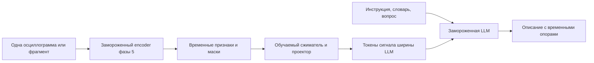

# Связка осциллограммного encoder и языковой модели

05.11.2026. Исследовательская идея и задания для внешнего обзора. Реализация и обучение не начаты. Это продолжение фаз 5–6, преимущественно за пределами текущей диссертации.

## Исходное решение автора

Сначала предполагается отдельно разметить осциллограммы или их фрагменты описательными текстами, возможно совместно с вузом. Существующие отчёты фазы 6 относятся к комплектам, в которых обычно несколько осциллограмм. Их предполагается использовать на позднем этапе для анализа всего эпизода. Отчёт не является готовой подписью к каждому файлу; подготовка первого корпуса не должна ждать окончания работы со всеми отчётами.

## Предварительная рекомендация

Проверять модальность «электрический сигнал» напрямую через обучаемый соединительный модуль. Начать с замороженного encoder фазы 5, небольшого временного преобразователя/сжимателя и замороженной открытой LLM. Сначала сравнить простой MLP-проектор после временного pooling с небольшим resampler на обучаемых запросах. Последний может извлекать ограниченное число векторов из переменной последовательности признаков. Полный Q-Former и вмешательство во внутренние слои LLM оставить следующими сравнениями, если простой вариант показывает конкретные ограничения.

Это инженерная гипотеза, а не результат обучения. SSL-реконструкция сама по себе не доказывает, что encoder сохранил признаки, необходимые для описания повреждения. Нужна предварительная проверка представлений на узких размеченных задачах.

Для encoder E и модуля Pθ схема имеет вид H=E(x), Z=Pθ(H,m,t), Z∈R^(M×d_LLM). В базовой конфигурации текущего encoder H имеет ширину 128; d_LLM берётся из config выбранного checkpoint, а не угадывается по названию семейства. Слова не обязаны соответствовать векторам Z: это непрерывные входные представления, обусловленные конкретным сигналом.

Последовательность для decoder-only LLM: инструкция и вопрос → токены сигнала с явными границами → начало ответа → текст ответа при teacher forcing. Точный порядок согласовать с chat template. Обучаем по loss целевого ответа, маскируя инструкцию, префикс, padding и прочие нецелевые позиции. Метки ответа не подаются в encoder или проектор. При выводе доступны только инструкция, вопрос и сигнал.

## Что означают методы на фотографиях

| Метод | Что обучается | Как связан с задачей |
|---|---|---|
| Prompt tuning | Набор непрерывных prompt-векторов для задачи | Сам по себе один общий prompt не передаёт содержимое новой осциллограммы |
| Проектор сигнала в soft tokens | Функция от признаков конкретного сигнала | Прямой первый кандидат для предлагаемой связки |
| Prefix tuning | Непрерывное обусловливание attention, в том числе на уровне слоёв | Можно исследовать вариант с K/V-префиксом, зависящим от сигнала; это отличается от только входных токенов |
| Bottleneck adapters | Дополнительные небольшие модули внутри модели | Без отдельного входа модальности не обеспечивают передачу осциллограммы |
| LoRA | Низкоранговые изменения линейных преобразований | Помогает адаптировать чтение представлений и стиль ответа; не заменяет канал передачи сигнала |
| Gated cross-attention | Дополнительные блоки доступа LLM к внешней памяти признаков | Позволяет подавать признаки внутрь слоёв, сохраняя исходные веса замороженными |

Фотографии относятся к [prompt tuning](https://aclanthology.org/2021.emnlp-main.243/), [adapters](https://arxiv.org/abs/1902.00751) и [LoRA](https://arxiv.org/abs/2106.09685). Различие с послойными непрерывными префиксами описано в [Prefix-Tuning](https://aclanthology.org/2021.acl-long.353/). Материалы лекции использованы как контекст идеи.

[BLIP-2](https://arxiv.org/abs/2301.12597) — первичный пример соединения замороженных encoder и LLM через обучаемый Q-Former. [Flamingo](https://arxiv.org/abs/2204.14198) — пример обучаемого resampler и gated cross-attention между замороженными слоями LLM. Это результаты для изображений, а не доказательство качества на осциллограммах. [ChatTS](https://arxiv.org/abs/2412.03104) рассматривает временные ряды как отдельную модальность и использует синтетические пары с текстами/вопросами; его обучаемые части и переносимость нужно разобрать отдельно. Эти работы — отправные точки, не исчерпывающий обзор.

## Что доступно в проекте

Проверен `osc_tools/ml/models/phasor_hierarchical.py`. `forward` принимает Re/Im, состояния каналов, временные координаты и маску. Возвращает `local_features` формы B×T×width (width=128 по умолчанию), а также реконструкцию. Локальные признаки взяты до глобальных блоков и fusion. Внутри локального окна внимание двунаправленное; это offline-представление, а не доказанный потоковый орган.

Глобальные `summary` и итоговые скрытые состояния после fusion вычисляются внутри, но сейчас не экспортируются как feature API. Для сравнения local/global/multiscale понадобится отдельный явный интерфейс с масками и временными интервалами; не следует выдавать реконструированные входы за глобальные скрытые признаки. Код в рамках этой задачи не менялся.

Уже смешанные локальные признаки не обеспечивают явной идентифицируемости каждого канала. Для ответов о конкретной фазе/канале может оказаться полезным доступ к более ранним поканальным признакам или параллельным измеряемым величинам. Временной порядок и абсолютные масштабы нельзя терять при сжатии.

Предлагаемые сравнения количества токенов, например M=16/32/64/128, являются сеткой пилота, не оптимальными значениями. Для длинной записи сравнить общий фиксированный бюджет с несколькими токенами на окно и ограничением суммарного контекста. Редкое короткое событие может исчезнуть при глобальном усреднении. Любой выбор окна по размеченным границам должен быть исключён из автономного теста либо явно обозначен как режим с заданным пользователем интервалом.

## Последовательность работы с данными

1. **Одиночные записи и фрагменты.** Эксперт видит сигнал и разрешённые метаданные, задаёт наблюдения, интервалы и неопределённость. Отдельно фиксируются выводы, требующие схемы сети, положения выключателей или иных документов. Нормальные и неоднозначные записи нужны наряду с аварийными.
2. **Комплект записей одного эпизода.** Каждая запись сохраняет ID, точку измерения, каналы, шкалу времени, качество синхронизации и происхождение. Модель получает несколько сигналов и должна связывать утверждения с нужными источниками, учитывать противоречия и отсутствие данных. Временное совмещение не предполагается по одному совпадению имён.
3. **Отчёт об эпизоде.** Сопоставляются сигналы и проверенный текст. Различаются описание по сигналам и анализ сигналов с доступными документами. Целевой отчёт и его пересказ не должны попадать во вход теста на восстановление отчёта. Документальные факты, не наблюдаемые в сигнале, нельзя включать в signal-only target как обязательные догадки.

17 комплектов в текущем плане фазы 6 — единицы документального корпуса, не 17 выверенных пар и не оценка достаточности обучающей выборки. Первичная разметка может формироваться на другой подборке осциллограмм. Размер корпуса определяется кривыми обучения и разнообразием независимых эпизодов, а не числом автоматически нарезанных окон.

## Обучение и ресурсы

Замороженный encoder можно выполнить заранее и кэшировать H, зафиксировав checkpoint, параметры подготовки, masks, times и происхождение. Для обучения Pθ **градиент должен пройти через LLM до Z**. У LLM выключают градиенты весов, но не оборачивают весь её forward в `no_grad`; иначе связь с проектором обрывается. Кэш признаков encoder экономит его вычисления, но не отменяет стоимость LLM backward.

Квантизация весов уменьшает память, но остаются активации, временные буферы, обучаемый модуль и его optimizer. При генерации дополнительно важен KV-cache. Документация [bitsandbytes в Transformers](https://huggingface.co/docs/transformers/main/en/quantization/bitsandbytes) описывает обучение дополнительных параметров при 4/8-bit базовых весах; совместимость конкретного пути градиента, ОС, GPU и версий нужно проверить мини-тестом.

«Qwen 27» оставлено как неопределённое обозначение автора, без догадки о точном checkpoint. Если имеется в виду dense-модель на 27 млрд параметров, одно хранение всех весов по 4 бита составляет 13,5 GB ≈12,6 GiB, ещё без служебных расходов. Это уже больше 8 GiB GPU; offload меняет размещение, но не делает обучение бесплатным. Для первоначальной проверки предложен класс 1–4B; существование, например, [Qwen3-4B](https://huggingface.co/Qwen/Qwen3-4B) подтверждено официальной карточкой. Это кандидат, не утверждение о лучшем актуальном выборе или гарантированном размещении.

[Интерфейс Qwen3 в Transformers](https://huggingface.co/docs/transformers/main/en/model_doc/qwen3) предусматривает `inputs_embeds`. У точной выбранной модели необходимо проверить forward, generation, chat template, позиции, padding и cache. Обычный текстовый chat API сам по себе не даёт доступа к произвольным внутренним векторам и обучению. GGUF-инференс также не следует автоматически считать средой для обучения проектора.

## Что будет убедительной проверкой

Сравнивать с текстовой сводкой измеренных признаков для LLM и с изображениями для VLM. Картинки остаются полезным baseline; их «возраст» не определяет качество. Модель с обученным мостом должна использовать конкретный сигнал, а не только подражать стилю разметки.

Обязательны подмена сигнала другим при неизменном вопросе, отсутствие сигнала, перестановка временных участков, изменение фазы/амплитуды с известным смыслом и удаление каналов. Проверять факты, числа, интервалы, ссылки на каналы, полноту и необоснованные утверждения; гладкость текста и оценка другой LLM недостаточны. Разбиение — по эпизодам/связанным записям до нарезки, с отдельной проверкой источников и simulation→real.

Небольшой мост может не справиться: encoder мог потерять нужную информацию, данных может не хватить для согласования, или замороженная LLM плохо использует этот канал. Следующий шаг выбирается по диагностике: улучшение данных/представления, resampler, затем cross-attention или мост+LoRA. KAN в мосте допустим как поздняя абляция к MLP, но не является условием передачи модальности.

## Единое задание для интернет-исследования

По уточнению автора 05.11.2026 прежние три задания заменены одним [исследовательским промптом о согласовании представлений разных модальностей с LLM](MODALITY_ALIGNMENT_RESEARCH_PROMPT.md). Три прежних файла удалены.

Фокус обзора — научные механизмы соединения encoder и языковой модели, временные ряды и перенос подходов из изображений, аудио и видео. Осциллограммы оставлены краткой мотивацией; конкретная архитектура и локальный пилот не задаются заранее. Этот файл сохраняет предварительные идеи проекта, но не ограничивает поиск исследователя.

После получения обзора вернуться к проектным решениям на основании найденных доказательств. Полноценный обзор ещё не получен. Короткая сверка первоисточников выполнена 05.11.2026; последние модели и лучшие методы не определялись.
