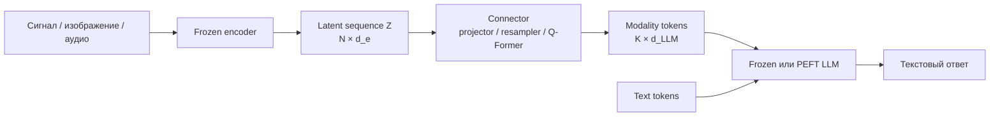
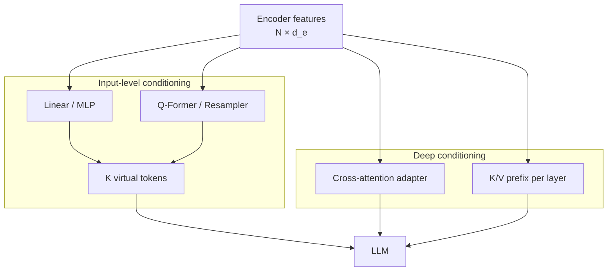
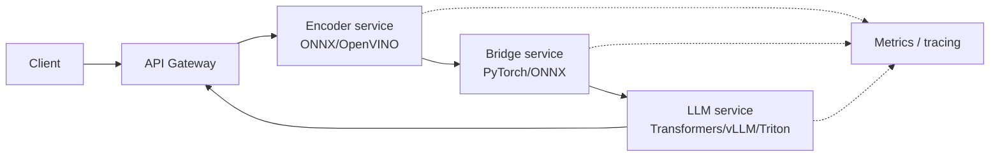
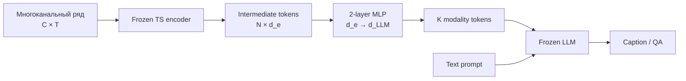

# Аналитический обзор соединения предобученных моделей разных модальностей

## Executive summary

**Контекст.** Конкретные модели пользователем не заданы — далее это отмечается как **«модели не указаны»**. Основной сценарий: имеется предобученный encoder некоторой неязыковой модальности — особенно многоканального временного ряда или физического сигнала — и предобученная LLM; требуется сделать так, чтобы LLM могла использовать представления encoder для описания, вопросно-ответного взаимодействия и рассуждения. Расширенный акцент на временных рядах, frozen encoder/frozen LLM и критической оценке доказательств соответствует приложенному заданию. fileciteturn0file0 Поиск выполнен **5 ноября 2026 года**; приоритет отдавался оригинальным статьям, официальным репозиториям и документации.

Главный вывод литературы: **«согласование пространств» не сводится к совпадению размерностей**. Линейное отображение из \(d_\text{enc}\) в \(d_\text{LLM}\) лишь делает тензоры совместимыми по форме; смысловая совместимость появляется только тогда, когда обучающий objective заставляет выход connector'а быть полезным для конкретной операции LLM — генерации, retrieval, QA или reasoning. Это хорошо видно в LLaVA: простая projection matrix переводит признаки CLIP в размерность word embeddings, но именно стадия feature alignment на image–caption парах обучает её так, чтобы LLM могла интерпретировать визуальные токены. BLIP-2 идёт дальше и показывает, что одного generative loss может быть недостаточно: Q-Former предварительно обучается на нескольких задачах cross-modal representation learning, а затем связывается с замороженной LLM. citeturn660548view0turn172779view2

Для уже обученного encoder временных рядов наиболее обоснованная стартовая стратегия — **не пытаться заставить его латентное пространство имитировать embeddings реальных слов**, а преобразовать последовательность признаков в небольшой набор **input-conditioned continuous tokens**, которые LLM использует как контекст. В простейшем случае это MLP/linear projector; при длинных или переменной длины последовательностях — resampler/Q-Former-подобный bottleneck; если информации нужно взаимодействовать с языковыми признаками на нескольких глубинах модели — cross-attention adapters. Frozen-language подходы начиная с Frozen, ClipCap, Flamingo и BLIP-2 показывают, что такое обусловливание возможно без изменения основных весов LLM, но Flamingo и BLIP-2 одновременно показывают, что более выразительный connector может существенно превосходить простой MLP в сложных задачах. citeturn263725academia3turn172779view1turn683249view2turn683249view3

Для временных рядов доказательная база существенно слабее, чем для vision-language. ChatTS — одна из наиболее прямых работ по native time-series QA/reasoning: ряд разбивается на patches, каждый patch кодируется 5-слойным MLP в пространство embeddings LLM и вставляется между текстовыми токенами; однако ChatTS использует **full-parameter SFT Qwen2.5-14B**, поэтому его результаты не доказывают, что bridge-only training будет достаточен. Работа Merrill et al. показывает противоположно важный результат: сильные LLM остаются слабыми в zero-shot reasoning по временным рядам; визуализация или текстуализация сами по себе проблему не решают. citeturn168519view4turn168519view3turn737611search3

Практически я рекомендую рассматривать три возрастающих по сложности baseline: **(A)** frozen encoder + 2-layer MLP projector + frozen LLM; **(B)** frozen encoder + learned-query resampler + frozen LLM; **(C)** тот же connector + LoRA в ограниченном наборе LLM attention layers. Переход к следующему варианту должен происходить не по ощущениям, а только если контролируемые ablations показывают, что предыдущий интерфейс ограничивает grounding. LoRA является способом изменить LLM, а не способом передать в неё новую модальность; knowledge distillation также требует обучения student и поэтому строго не относится к интеграции «без дообучения». citeturn263725academia6turn607813academia25

## Что именно соединяется между двумя моделями

### Типы моделей и интерфейсов

В общей форме первая модель реализует

\[
E: X_m \rightarrow Z_m,\qquad Z_m\in \mathbb{R}^{B\times N\times d_e},
\]

где \(X_m\) — изображение, аудио, временной ряд, набор сенсорных каналов или иная модальность. LLM ожидает последовательность embeddings

\[
H_\text{text}\in\mathbb{R}^{B\times T\times d_l}.
\]

Connector \(C\) формирует

\[
C(Z_m)\rightarrow H_m\in \mathbb{R}^{B\times K\times d_l},
\]

после чего \(H_m\) либо конкатенируется с token embeddings, либо используется как K/V memory в cross-attention, либо вводится в отдельные слои LLM. Такой принцип лежит в основе Frozen, LLaVA, ClipCap, BLIP-2 и Flamingo, хотя место инъекции и сложность connector'а у них различаются. citeturn263725academia3turn660548view0turn172779view1turn683249view2

| Комбинация | Типичный вход encoder | Выход encoder | Интерфейс с LLM | Типичные задачи |
|---|---|---|---|---|
| Transformer time-series encoder + LLM | \(B\times C\times T\) | patches/tokens \(B\times N\times d_e\) | MLP / resampler → LLM embeddings | captioning, QA, reasoning |
| CNN/ViT + LLM | image tensor | spatial/patch tokens | linear/MLP, Q-Former, cross-attention | captioning, VQA |
| Audio encoder + LLM | waveform/spectrogram | frame embeddings | Q-Former/resampler/cross-attention | ASR, captioning, audio QA |
| Video encoder + LLM | frame sequence | spatio-temporal tokens | resampler + cross-attention | video QA, dialogue |
| Sensor encoder + LLM | multichannel signals | temporal/channel tokens | projection / special-token interface | HAR, explanation, QA |
| Две API-модели | JSON/text/media | текст/structured output | sequential pipeline | orchestration, tool use |

Flamingo, например, преобразует переменное число spatio-temporal features в фиксированные 64 visual tokens с помощью Perceiver Resampler и затем вводит их в LLM через gated cross-attention. SALMONN аналогично соединяет Whisper и BEATs с Vicuna через window-level Q-Former и LoRA. ImageBind решает другую задачу: строит **общее contrastive embedding space** шести модальностей; это полезно для retrieval, но само по себе не создаёт generative interface к LLM. citeturn683249view2turn172779view4turn195240academia8

### Четыре разных значения «alignment»

**Геометрическое выравнивание** означает, что близость в латентном пространстве отражает cross-modal semantic similarity. CLIP и ImageBind — классические примеры: обучение на contrastive objective делает пары изображение–текст или различные модальности сопоставимыми по similarity. Такое пространство хорошо подходит для retrieval и zero-shot classification, но не гарантирует, что decoder-only LLM сможет использовать эти векторы как причинно значимый контекст. citeturn607813academia24turn195240academia8

**Интерфейсное выравнивание** означает преобразование признаков в форму, допустимую на входе LLM. В LLaVA trainable matrix \(W\) переводит CLIP features в word-embedding dimensionality; authors прямо описывают первый этап как обучение compatible visual tokenizer. При этом равенство \(d_e=d_l\) или линейная проекция не являются доказательством semantic alignment — оно появляется из likelihood objective на связанных image-text данных. citeturn660548view0

**Generative conditioning** означает, что модальные векторы не обязаны быть близкими к embeddings каких-либо реальных слов. Они должны лишь приводить LLM в такое hidden state distribution, при котором условное распределение \(p(y|x_m,q)\) корректно зависит от модальности. Frozen именно обучает continuous visual prefixes, пропуская градиент через замороженную LLM; ClipCap делает аналогичное отображение CLIP representation в prefix для GPT-2. citeturn848737view0turn172779view1

**Deep conditioning** вводит модальную информацию не только на входе, но и внутри LLM. Flamingo вставляет trainable gated cross-attention blocks между frozen language blocks; ablation показывает, что interleaved cross-attention лучше варианта с блоками, добавленными только сверху, а слишком редкая инъекция снижает качество. Это более сильный способ интеграции, но он дороже и сложнее экспортируется/обслуживается. citeturn683249view1turn683249view3



### Альтернативы непрерывному connector'у

Вместо continuous tokens модальность можно **дискретизировать** в коды и включить в общий словарь. Это удобно для unified autoregressive modeling, но требует обученного modality tokenizer и обычно большей перестройки pipeline. Другой вариант — преобразовать сигнал в текстовое описание признаков или график и использовать обычную LLM/VLM. Для временных рядов это полезный baseline: Merrill et al. специально сравнивают текстовые и визуальные способы представления и показывают, что zero-shot reasoning остаётся трудным; ChatTS также отмечает ограничения визуального подхода по точности локальных значений. citeturn737611search8turn172779view0

## Карта методов интеграции и качество доказательств

### Без изменения весов исходных моделей

Строго «без дообучения» означает, что **не обучается вообще ничего**. Тогда доступны только orchestration-методы: последовательный pipeline, параллельное ensembling, преобразование выхода первой модели в текст или structured data, prompting и tool calling. Если же обучается projector, adapter или prompt, это уже минимальное обучение, даже если encoder и LLM frozen.

| Подход | Обучение | Где возникает fusion | Плюсы | Основные ограничения |
|---|---:|---|---|---|
| Последовательный API pipeline | нет | на уровне текста/JSON | простой, модульный | потеря непрерывной информации |
| Parallel ensemble | нет | на уровне logits/ответов | robustness | дорого по inference |
| График/спектр → VLM | нет | внутри готовой VLM | быстрый baseline | resolution/scale errors |
| Извлечение численных features → prompt | нет | текстовый контекст | объяснимость | handcrafted bottleneck |
| Retrieval + prompting | нет | prompt | не требует trainable bridge | зависит от retrieval |
| Distillation | **да** | student model | компактный inference | не является no-training method |

Knowledge distillation по определению обучает student на soft/softened targets teacher'а, поэтому логически относится к этапу обучения/компрессии, а не к zero-training integration. citeturn607813academia25

### Минимально обучаемый connector

Наиболее важные семейства таковы.

| Семейство | Connector | Что frozen | Типичные losses | Доказательная база |
|---|---|---|---|---|
| Linear/MLP projector | \(N\times d_e\to N\times d_l\) | encoder + иногда LLM | autoregressive CE | LLaVA, ClipCap |
| Input-conditioned prefix | sample → \(K\) virtual tokens | обычно LLM | CE | Frozen, ClipCap |
| Q-Former | learned queries cross-attend encoder | encoder + LLM | contrastive, matching, generation | BLIP-2 |
| Perceiver Resampler | variable \(N\to K\) | encoder + LM | generative CE | Flamingo |
| Cross-attention adapters | modality memory в hidden layers | базовые LM blocks | generative CE | Flamingo |
| PEFT + connector | projector + LoRA/adapters | основная часть LLM | CE/instruction tuning | SALMONN |
| Full/partial fine-tuning | connector + часть/вся LLM | encoder часто frozen | CE + auxiliary | LLaVA stage 2, ChatTS |

В LLaVA первый этап обучал только projection matrix на 595k image-text pairs, сохраняя encoder и LLM frozen; второй этап уже обновлял LLM. Авторы также показали, что пропуск alignment pretraining ухудшал ScienceQA result, то есть простой projector работает не потому, что совпала размерность, а потому что его отдельно обучили на cross-modal data. citeturn660548view0turn660548view2

ClipCap особенно интересен как минималистичный precedent: CLIP embedding преобразуется lightweight mapping network в fixed-length prefix GPT-2; authors сообщают, что variant с frozen CLIP и frozen GPT-2 остаётся работоспособным. Это аргумент в пользу bridge-only MVP, но переносить его напрямую на физические сигналы нельзя: CLIP уже был обучен на image–text semantic supervision, то есть его latent space значительно ближе к языку, чем representation encoder'а, обученного, например, на реконструкции формы сигнала. citeturn172779view1

BLIP-2 предоставляет более сильное свидетельство в пользу learnable query bottleneck. Авторы прямо утверждают, что чистого image-to-text generation objective недостаточно для эффективного bridging frozen modalities, и вводят две стадии: сначала Q-Former обучается representation alignment, затем его output соединяется с frozen LLM для generative learning. На retrieval дополнительный image-grounded generation loss также улучшал результаты. citeturn172779view2turn683249view4

Flamingo показывает условия, при которых bridge становится глубже. Его Perceiver Resampler сжимает variable-size feature maps до 64 tokens; в ablations он превосходил plain Transformer/MLP при заданном budget. Gated cross-attention в нескольких слоях LLM давал лучший результат, чем grafting только после LM; однако увеличение частоты cross-attention повышало compute cost, и авторы показывали явный performance/throughput trade-off. citeturn683249view2turn683249view3

### Prompt tuning, prefix tuning и LoRA — не одно и то же

Обычный **soft prompt** — набор task-specific trainable vectors, одинаковый для всех samples. Он не кодирует конкретный входной сигнал. В Prompt Tuning frozen model адаптируется через такие vectors; Prefix-Tuning добавляет continuous prefixes, доступные attention layers. Для мультимодального интерфейса требуется **input-conditioned prefix** \(P(x)\), то есть connector, который строит prefix из encoder output. citeturn263725search2turn263725search1

LoRA добавляет low-rank updates к весовым матрицам Transformer и снижает число trainable parameters; она не отвечает на вопрос, **как** signal representation попадает в LLM. Поэтому типичная архитектура имеет одновременно projector/Q-Former и LoRA. SALMONN — именно такой пример: audio encoders → window-level Q-Former → Vicuna, плюс LoRA для адаптации LLM. citeturn263725academia6turn172779view4



### Данные и вычисления

Опубликованные объёмы очень различаются и **не задают универсального minimum dataset size**. LLaVA использовала сотни тысяч image-text pairs для alignment и порядка \(10^5\) instruction examples; ChatTS — 35k+35k+35k alignment examples плюс 24,270 TSEvol и 5,050 instruction-following examples, но при этом full-finetuned 14B LLM. BLIP-2 и Flamingo обучались на гораздо больших multimodal corpora. Следовательно, вопрос «сколько данных нужно» определяется semantic distance encoder representation от языка, сложностью downstream tasks и степенью адаптации LLM. citeturn660548view3turn168519view3turn172779view2turn172779view3

| Режим | Trainable параметры | Ориентир данных | Compute относительно full FT | Когда разумен |
|---|---:|---:|---:|---|
| Linear projector only | ~\(d_e d_l\) | \(10^4–10^6\) пар, сильно task-dependent | низкий–средний | хороший encoder, простая связь |
| MLP / small Transformer | ~10–100M | \(10^4–10^6+\) | средний | нелинейное отображение |
| Q-Former/resampler | десятки–сотни M | обычно большой paired corpus | средний | long/variable modality tokens |
| Projector + LoRA | connector + <нескольких % LLM | \(10^4–10^6\) task examples | средний | frozen LLM недостаточно пластична |
| Partial/full LLM FT | много | обычно больше | высокий | сложное reasoning/instruction following |

Важно: frozen LLM не означает «без backward». Если loss зависит от connector output перед LLM, градиент должен пройти через вычислительный граф LLM обратно к connector'у. Уже Frozen явно описывал frozen LM с back-propagation through it. Экономятся optimizer states и weight gradients LLM, но сохраняется значительная стоимость activations; gradient checkpointing, mixed precision и quantization поэтому остаются актуальны. citeturn848737view0

## От изображений и аудио к временным рядам

### Что переносится достаточно надёжно

Первый устойчивый принцип — **сильный pretrained encoder можно сохранить frozen**, если его representations содержат информацию, необходимую downstream task. Это подтверждают vision-language работы Frozen, LLaVA stage 1, BLIP-2 и Flamingo. Но encoder, обученный под одну цель, может потерять детали, необходимые для другой: LLaVA, например, получила лучший ScienceQA result от penultimate CLIP layer, чем от последнего, что authors связывают с сохранением более локальных признаков. Это важный аргумент в пользу сравнения нескольких уровней time-series encoder, а не только final pooled embedding. citeturn660548view2

Второй принцип — **сжатие variable-length sequence через learned queries** особенно полезно при длинном входе. Flamingo использует fixed 64 output tokens именно для ограничения cross-attention complexity; BLIP-2 использует learnable queries как information bottleneck. Для временных рядов это напрямую мотивирует temporal resampler, но остаётся риск, что редкое короткое событие будет потеряно при агрессивном compression. citeturn683249view2turn172779view2

Третий принцип — **semantic alignment и instruction tuning — разные стадии**. LLaVA разделяет feature alignment и visual instruction tuning; BLIP-2 — representation learning и generative learning; ChatTS — alignment и SFT. Это сильный повторяющийся pattern: сначала научить интерфейс переносить observable content, затем обучать сложному поведению модели. citeturn660548view3turn172779view2turn168519view3

### Что показано непосредственно для временных рядов

ChatTS является наиболее прямым примером time-series-as-native-modality. Он делит series на fixed-size patches, пропускает каждый patch через 5-layer MLP, переводя его в размерность text embedding, и вставляет полученные tokens в позиции `<ts>` внутри text sequence. Для сохранения абсолютных значений после min-max normalization масштаб и offset добавляются в prompt. Такой дизайн показывает, что очень простой time-series frontend может работать, но из-за full-parameter SFT нельзя отделить вклад MLP от адаптации самой LLM. citeturn168519view1turn168519view3

Официальный ChatTS repository содержит weights, synthetic-data tooling, evaluation code и Transformers/vLLM integration; в репозитории также указано, что обучение и inference ориентированы на достаточно тяжёлые GPU, а рекомендуемая длина series исторически находилась примерно в диапазоне 64–1024. Это делает работу воспроизводимой лучше многих концептуальных TS-LLM papers, хотя synthetic data remains an important domain-shift concern. citeturn122124search0turn122124search1

TSLM занимается именно descriptive caption generation, а не только forecasting; он использует time-series representations и text prompts в encoder-decoder setup и борется с нехваткой caption data через synthetic generation и cross-modal retrieval filtering. К моменту поиска работа опубликована в *Engineering Applications of Artificial Intelligence*. citeturn737611academia9turn737611search2

SensorLLM фокусируется прежде всего на human-activity recognition, а не свободной генерации, но важен как пример channel-aware sensor-language alignment: в работе используются специальные tokens каналов и автоматически сгенерированные trend descriptions, после чего проводится task-aware tuning. Его результаты полезны как evidence для alignment, но не являются доказательством open-ended signal description. citeturn418780academia1

Новейшая работа *Perceive, Solve, Reason* от октября 2026 года сообщает, что dedicated time-series encoder заметно улучшает reasoning по сравнению с textualization и что последовательное обучение perception→problem solving→reasoning превосходит простое mixing тех же данных; однако на дату поиска это свежий preprint, поэтому выводы следует считать предварительными до независимой репликации. citeturn737611academia10

ClinPRISM, также preprint 2026 года, интересен именно для irregular time series: multi-scale encoder + temporal evidence distiller сжимают trajectory до 16 LLM-compatible tokens, а progressive alignment используется до instruction tuning. Это наиболее близкий опубликованный механизм к задаче «длинные/неравномерные сигналы → небольшой набор informative tokens», но медицинская специфика и отсутствие длительной независимой проверки ограничивают переносимость результата. citeturn737611academia11

### Что пока не доказано

Главное отрицательное свидетельство даёт Merrill et al.: на специально построенных задачах etiological reasoning, QA и context-aided forecasting современные LMs существенно уступали людям и лишь немного превосходили случайный baseline на части reasoning tasks. Следовательно, способность модели выдавать правдоподобный caption или forecast нельзя считать доказательством того, что она понимает причинную или временную структуру сигнала. citeturn737611search3

Модуль согласования **не может восстановить информацию, которой нет в \(Z_m\)**. Если encoder через global pooling потерял точное положение импульса, channel identity или absolute scale, downstream projector может лишь статистически угадать эти свойства. Поэтому для физического сигнала следует сравнивать token-level intermediate features, multi-scale representations и final embedding, используя targeted probes; LLaVA ablation с penultimate vs final CLIP layer — полезная аналогия этого принципа. citeturn660548view2

Для многоканальных физических рядов также остаются открыты вопросы channel semantics, asynchronous sampling, missing values, calibration, absolute units и редких коротких событий. ChatTS специально сохраняет scale/offset в текстовом контексте, а ClinPRISM моделирует irregularity, но нет оснований считать эти решения универсальными. citeturn168519view1turn737611academia11

## Практическая реализация, ресурсы и deployment

### Архитектурные паттерны

**Паттерн A: простой projector в embedding space.**

```python
class ModalityBridge(nn.Module):
    def __init__(self, encoder, d_enc, d_llm):
        super().__init__()
        self.encoder = encoder.eval()
        for p in self.encoder.parameters():
            p.requires_grad = False

        self.projector = nn.Sequential(
            nn.Linear(d_enc, d_llm),
            nn.GELU(),
            nn.Linear(d_llm, d_llm),
        )

    def forward(self, x):
        with torch.no_grad():
            z = self.encoder(x)          # [B, N, d_enc]
        return self.projector(z)         # [B, N, d_llm]

# modality_tokens are inserted into inputs_embeds at <modality> position
out = llm(inputs_embeds=combined_embeddings, labels=labels)
loss = out.loss
loss.backward()
```

Это архитектурно близко к LLaVA/ChatTS: feature sequence проецируется в размерность LM embeddings и помещается среди text tokens. Для bridge-only training нельзя оборачивать **LLM** в `torch.no_grad()`, иначе градиент не дойдёт до projector; замораживаются параметры, но computational graph через LLM остаётся. citeturn660548view0turn168519view4turn848737view0

**Паттерн B: learned-query resampler.**

```python
# z: [B, N, d]
queries = self.query_tokens.expand(B, K, d)
q = self.q_proj(queries)
k = self.k_proj(z)
v = self.v_proj(z)

compressed, _ = self.cross_attn(q, k, v)
modality_tokens = self.to_llm_dim(compressed)   # [B, K, d_llm]
```

Это упрощённая версия идеи Q-Former/Perceiver Resampler: \(N\) encoder tokens сжимаются до фиксированного \(K\). В Flamingo именно compression до fixed token count используется для контроля complexity, а BLIP-2 обучает queries извлекать language-relevant visual information. citeturn683249view2turn172779view2

**Паттерн C: gated cross-attention.**

```python
h = frozen_llm_block(h)

cross = attention(
    query=h,
    key=modality_memory,
    value=modality_memory
)

h = h + torch.tanh(self.gate) * cross
```

Flamingo использовал zero-initialized tanh gating; его ablation показывал ухудшение и нестабильность без такого gating. Этот вариант предпочтителен, если input-prefix bottleneck явно недостаточен, но он требует вмешательства в архитектуру LLM и сложнее для generic inference servers. citeturn683249view1

### Фреймворки и форматы

Для исследования наиболее прямой stack — **PyTorch + Hugging Face Transformers + PEFT**: Transformers уже поддерживает multimodal processors и chat templates, где text, image, audio и video content формируются единым интерфейсом. citeturn689049search2

Для interchange современный PyTorch рекомендует новый `torch.export`/Dynamo-based ONNX exporter; документация прямо указывает `torch.onnx.export(..., dynamo=True)` как рекомендуемый путь, тогда как старый TorchScript-based export считается legacy. citeturn689049search5turn689049search9

ONNX Runtime позволяет выбирать execution providers для CPU, CUDA и других backends и поддерживает quantization; это удобно, если encoder и connector должны работать отдельно от LLM. OpenVINO может конвертировать PyTorch напрямую либо через ONNX и особенно полезен для Intel CPU/iGPU deployment. citeturn689049search35turn689049search43turn689049search33

Triton Inference Server поддерживает HTTP/gRPC, dynamic batching и ensemble models, поэтому pipeline `encoder → connector → LLM` можно обслуживать как композицию сервисных стадий. Kubernetes GPU scheduling требует vendor device plugin, а Docker предоставляет GPU devices через container runtime. citeturn689049search6turn689049search1turn689049search24turn689049search26



### Оценка ресурсов для MVP

Ниже — **инженерные ориентиры, а не числа из конкретной статьи**. Они предполагают decoder-only LLM порядка 7–8B, frozen encoder и bridge до ~50M params. Фактическая память зависит от sequence length, attention implementation, batch size, KV cache и checkpointing.

| Режим | GPU RAM, ориентир | CPU RAM | Комментарий |
|---|---:|---:|---|
| Inference 7–8B BF16 | ~16–24 GB | 16–32 GB | weights + KV/cache overhead |
| Inference 7–8B 4-bit | ~6–12 GB | 16–32 GB | зависит от backend |
| Bridge-only training BF16 | ~24–48 GB | 32–64 GB | activations LLM всё ещё нужны |
| LoRA + connector | ~24–48+ GB | 32–64 GB | зависит от targets и context |
| Full FT 7–8B | ~80 GB или multi-GPU | 64+ GB | ZeRO/FSDP обычно необходимы |
| CPU-only inference | 32–64+ GB RAM | — | quantized model; latency значительно выше |

Для edge/CPU-only логичнее разделить систему: компактный encoder + небольшой projector локально, а LLM — quantized 1–4B либо удалённый сервис. OpenVINO/ONNX Runtime дают portable CPU execution, но конкретный latency необходимо измерять на целевом железе — официальная ONNX Runtime documentation подчёркивает device/model dependency performance. citeturn689049search58turn689049search55

### Лицензии и reproducibility

Лицензии надо проверять **для всех трёх частей**: encoder, LLM и training data. Возможность скачать weights не означает автоматическое право коммерческого использования или redistribution. Например, официальный LLaVA repository имеет собственную Apache-2.0 code license, но использует external base models и datasets с отдельными условиями; ChatTS также распространяет code/data/model components отдельно. citeturn607813search0turn122124search1

## Риски, метрики и план тестирования

### Основные технические риски

| Риск | Механизм | Как обнаружить | Митигировать |
|---|---|---|---|
| Dimension-compatible, semantically useless bridge | projector обучился слабому mapping | shuffled modality test | contrastive/QA alignment stage |
| Encoder information loss | pooling/late layer потерял детали | probes разных layers | использовать intermediate tokens |
| Token bottleneck | малый \(K\) теряет редкие события | sweep \(K\), event recall | hierarchical/multi-scale resampler |
| Hallucination | LLM полагается на priors | no-modality baseline | grounding loss, abstention |
| Scale/unit loss | normalization уничтожает absolute values | numerical QA | metadata/scale tokens |
| Channel mixing | пропала channel identity | channel permutation test | channel embeddings |
| Latency blow-up | длинный modality prefix | p95 latency | compression/resampling |
| Distribution shift | synthetic→real | held-out real entities | real-data adaptation |
| Catastrophic language degradation | aggressive LLM FT | text-only regression suite | LoRA/frozen blocks |
| License incompatibility | разные model/data terms | legal review | permissive components |

Важнейший контроль — **no-modality test**: заменить modality tokens нулями или удалить их. Если output quality почти не меняется, модель, скорее всего, отвечает по text priors. Ещё сильнее shuffled/mismatched test: заменить сигнал сигналом другого sample. Если ответ остаётся прежним, grounding недостаточен. Такой класс проверок особенно необходим потому, что Merrill et al. показали слабость LLM на time-series reasoning, несмотря на убедительно звучащие language outputs. citeturn737611search3

### Метрики

Для свободного captioning нельзя полагаться только на BLEU/ROUGE/CIDEr: они измеряют surface similarity и могут штрафовать корректные paraphrases или вознаграждать шаблонность. Их имеет смысл дополнять **fact extraction**: тренд, направление, число событий, временная позиция, участвующие каналы, амплитуда и relation между каналами. В vision-language benchmarks LLaVA и Flamingo используют как generative, так и task-specific accuracy metrics; ChatTS отдельно оценивает alignment и reasoning tasks. citeturn683249view3turn168519view3

Рекомендуемый набор:

| Категория | Метрики |
|---|---|
| Semantic QA | exact match, F1, task accuracy |
| Numerical | MAE/MAPE по извлечённым числам, tolerance accuracy |
| Temporal grounding | interval IoU, event timestamp error |
| Channel grounding | channel identification accuracy |
| Captioning | CIDEr/BERT-like similarity + factual precision/recall |
| Hallucination | unsupported fact rate |
| Modality dependence | performance drop при shuffled/no modality |
| Robustness | noise/SNR curves, missing-channel degradation |
| Latency | p50/p95/p99 end-to-end |
| Throughput | samples/s, output tokens/s |
| Memory | peak GPU/CPU RAM |
| Calibration | selective accuracy / abstention curve |

### Контрольный test plan

Первый блок должен проверять **perception**, а не language style: синусоидальный тренд, step, spike, dip, локальное изменение частоты, два одинаковых события с разной амплитудой, multi-channel lag, anti-correlation, missing channel, irregular timestamps. Правильные ответы желательно генерировать алгоритмически, чтобы ground truth был точным.

Второй блок — **grounding adversarial controls**: shuffle signal между prompts, замена только одного канала, временной reversal, масштабирование амплитуды, перестановка каналов, вставка короткого события. Такие тесты отвечают на главный исследовательский вопрос: действительно ли output изменяется причинно вслед за сигналом.

Третий блок — **real held-out data** с разделением по независимым объектам/устройствам/эпизодам, а не случайным окнам одного события. Это критично для связанных временных рядов: иначе соседние segments могут дать leakage.

Четвёртый блок — **baseline ladder**: text statistics → graph/VLM → raw values in prompt → frozen projector → resampler → projector+LoRA. Только сравнение на одинаковых splits и одинаковой LLM позволяет сделать вывод о ценности конкретного connector'а.

## Рекомендации по MVP и дорожная карта

### Минимальный исследовательский MVP

Для описанного сценария с уже обученным encoder временных рядов наиболее рациональный первый эксперимент — **encoder frozen, LLM frozen, trainable 2-layer MLP projector**, работающий не с одним pooled vector, а с sequence features выбранного intermediate layer. Модели не указаны, поэтому конкретный dimensionality и context length — **не указано**.



Первый MVP должен отвечать не на вопрос «получается ли красивый текст?», а на три более жёстких вопроса: сохраняет ли encoder нужную информацию; может ли простой bridge сделать её доступной LLM; использует ли LLM signal tokens причинно. Именно эти вопросы различают архитектурные гипотезы и не требуют сразу строить сложную multimodal model.

**Ориентировочная последовательность** — это инженерная оценка, не результат литературы: базовый projector prototype обычно требует порядка нескольких дней разработки и отладки; controlled dataset/evaluation занимает больше времени, чем сам connector. Для ~10–100k paired examples и 7–8B frozen LLM реалистична одна GPU 24–48 GB при малом batch, gradient accumulation и checkpointing; перед фиксацией бюджета это надо подтвердить профилированием конкретных моделей.

### Когда усложнять connector

Если projector различает глобальные patterns, но теряет локальные события и sequence слишком длинная, следующий шаг — **learned-query resampler**, причем \(K\) надо sweep'ить, а не выбирать произвольно. Flamingo даёт сильное основание считать learned resampling эффективнее простого pooling при variable-length high-dimensional features. citeturn683249view2

Если projector/resampler хорошо проходит perception controls, но LLM плохо отвечает на task instructions или плохо объединяет сигнал с language context, имеет смысл добавить **LoRA** в ограниченные attention/MLP modules. Это тестирует гипотезу «representation уже доступна, но frozen LLM не умеет ею пользоваться». SALMONN подтверждает практическую жизнеспособность такой комбинации для аудио. citeturn172779view4turn263725academia6

Если modality information требуется на разных уровнях abstraction или длинный prefix слишком дорог, следует тестировать **cross-attention adapters**. Flamingo предоставляет наиболее убедительную ablation evidence в пользу deep injection, но цена — сложность модели, дополнительная latency и менее простая совместимость с standard LLM-serving stack. citeturn683249view3

Если все bridge-only варианты упираются в потолок и ablations показывают, что encoder representations недостаточны, тогда целесообразна **частичная разморозка encoder** — сначала верхних слоёв или adapter/LoRA. Полная адаптация encoder имеет смысл последней, поскольку она повышает риск catastrophic forgetting и требует существенно больше real paired data.

### Стратегия данных

На первом этапе полезны автоматически проверяемые synthetic samples, потому что для трендов, spikes, periodicity, lag и channel relations можно получить точный ground truth. ChatTS показывает масштабируемость synthetic alignment data, но сами authors указывают необходимость real-world data для дальнейшего улучшения. citeturn168519view3turn168519view4

Второй этап — реальные пары «signal segment → factual description», где target содержит **только наблюдаемое из входа**. Следует разделять наблюдаемое, derived numerical facts и external/domain knowledge. Иначе LLM будет поощряться генерировать сведения, которые невозможно вывести из сигнала.

Третий этап — question-answer data с контрфактическими и negative examples: «недостаточно данных», mismatched signals, missing channels. Это необходимо для обучения отказу и снижения hallucination.

### Мониторинг при масштабировании

В production мониторить нужно не только token latency и error rate, но и **modality utilization**. Полезны периодические canary tests с intentionally corrupted/shuffled inputs, distribution drift по encoder features, доля ответов с unsupported numerical claims и regression на text-only capabilities после PEFT/full fine-tuning.

Triton ensemble scheduler, Kubernetes GPU scheduling и standardized ONNX/OpenVINO interfaces позволяют разнести encoder, connector и LLM по независимым deployment units; это особенно удобно, если encoder должен работать near-edge, а LLM централизована. citeturn689049search1turn689049search24turn689049search44

### Аннотированная подборка ключевых источников

1. **Frozen — Multimodal Few-Shot Learning with Frozen Language Models, NeurIPS 2021.** Ключевой precedent для continuous sample-conditioned prefixes и frozen LLM; особенно важно, что gradient проходит через frozen LM. Не доказывает sufficiency bridge-only для arbitrary pretrained encoder. citeturn263725academia3turn848737view0  
   Статья: https://arxiv.org/abs/2106.13884

2. **ClipCap, 2021.** Простая mapping network между CLIP и GPT-2; полезный baseline для projector-only architecture. Ограничение: CLIP representation уже языково-согласован contrastive pretraining. citeturn172779view1  
   Статья: https://arxiv.org/abs/2111.09734  
   Код: https://github.com/rmokady/CLIP_prefix_caption

3. **Flamingo, NeurIPS 2022.** Наиболее полезен для Perceiver Resampler, gated cross-attention и ablation trade-offs между depth of injection, throughput и quality. citeturn683249view2turn683249view3  
   Статья: https://arxiv.org/abs/2204.14198

4. **BLIP-2, 2023.** Самая важная работа для Q-Former и двухстадийного alignment frozen vision encoder ↔ frozen LLM. Особенно читать Sections 3–4 и ablations objectives. citeturn172779view2turn683249view4  
   Статья: https://arxiv.org/abs/2301.12597  
   Код: https://github.com/salesforce/LAVIS

5. **LLaVA, NeurIPS 2023.** Показывает, насколько далеко можно зайти с простой linear projection и хорошей alignment/instruction data; важно различать projector-only first stage и LLM tuning second stage. citeturn660548view0turn660548view3  
   Статья: https://arxiv.org/abs/2304.08485  
   Код: https://github.com/haotian-liu/LLaVA

6. **SALMONN, 2023.** Полезный audio analogue: два frozen auditory encoders, window-level Q-Former и LoRA. Читайте architecture и activation-tuning experiments; работа показывает также risk task overfitting. citeturn172779view4  
   Статья: https://arxiv.org/abs/2310.13289  
   Код: https://github.com/bytedance/SALMONN

7. **ImageBind, CVPR 2023.** Важен для понимания разницы между joint contrastive embedding space и generative LLM conditioning. citeturn195240search5  
   Статья: https://arxiv.org/abs/2305.05665

8. **Language Models Still Struggle to Zero-shot Reason about Time Series, Findings EMNLP 2024.** Один из самых важных negative/control papers: показывает, что fluent language и forecasting не равны time-series reasoning. citeturn737611search3  
   Статья: https://aclanthology.org/2024.findings-emnlp.201/  
   Код: https://github.com/behavioral-data/TSandLanguage

9. **ChatTS, VLDB 2025.** Наиболее прямой reference для native multivariate time-series QA/reasoning, patch MLP interface, value preservation и synthetic alignment. Его нельзя цитировать как доказательство frozen-LLM connector-only режима, поскольку основная модель проходит full-parameter SFT. citeturn168519view3turn122124search1  
   Статья: https://arxiv.org/abs/2412.03104  
   Код: https://github.com/NetManAIOps/ChatTS

10. **TSLM, 2025.** Прямой источник по time-series captioning и synthetic caption data; полезен для data-generation side исследования. citeturn737611search2  
    Статья: https://arxiv.org/abs/2501.01832

11. **ClinPRISM, 2026, preprint.** Перспективен для irregular/multi-scale time series и aggressive token compression. Пока доказательная уверенность ниже из-за свежести результата. citeturn737611academia11  
    Статья: https://arxiv.org/abs/2607.25947

12. **Perceive, Solve, Reason, 2026, preprint.** Важен как новая evidence в пользу staged curriculum perception→reasoning и dedicated TS encoder; требует независимой репликации. citeturn737611academia10  
    Статья: https://arxiv.org/abs/2610.23521

**Итоговая оценка.** Наиболее убедительные основания сегодня имеют три механизма: **sample-conditioned continuous tokens через простой projector**, если encoder representation уже семантически близко к задаче; **learned-query compression/Q-Former/Perceiver**, когда вход длинный, переменной длины или содержит много избыточных признаков; **cross-attention/PEFT**, когда frozen LLM не может достаточно эффективно использовать внешний контекст только через input embeddings. Это подтверждается несколькими независимыми линиями vision/audio исследований. citeturn172779view1turn172779view2turn683249view2turn683249view3turn172779view4

Для временных рядов особенно перспективна архитектура **sequence-preserving encoder → small learned resampler/projector → LLM**, с явными temporal/channel positional features и без преждевременного pooling. Однако уверенность в том, что frozen encoder + frozen LLM + bridge всегда достаточно, сегодня опережает доказательства: наиболее сильные time-series systems либо full-finetune LLM, либо ещё являются свежими preprints, а независимые zero-shot исследования показывают существенные провалы reasoning. Поэтому научно наиболее защищаемая стратегия — начать с минимального frozen bridge, но заранее построить ablation ladder, способную доказать, когда именно необходимо усложнение connector'а или адаптация основных моделей. citeturn168519view3turn737611search3turn737611academia10turn737611academia11