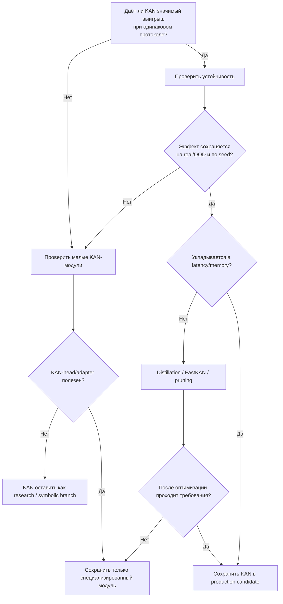
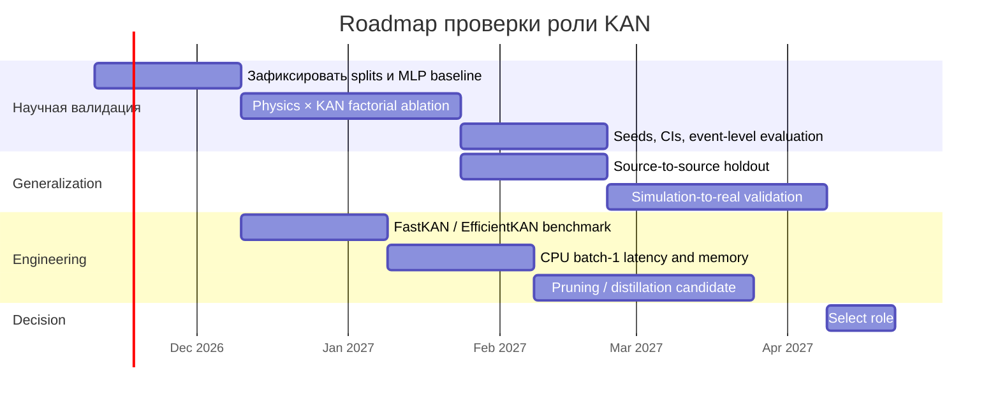

# Актуальность Kolmogorov–Arnold Networks для физически структурированного анализа осциллограмм и задач РЗА

## Executive summary

После чтения `KAN_RESEARCH_PROMPT` неопределённость в аббревиатуре снимается: под **KAN** в данном исследовании понимаются **Kolmogorov–Arnold Networks**, а не «контекстно-адресные нейросети». Целевая область — анализ реальных и моделируемых электрических осциллограмм, РЗА и БАВР, включая распознавание аварийных режимов, орган направления мощности, ОЗЗ/ДПОЗЗ, self-supervised pretraining и будущий переход от большой offline-модели к компактному прикладному органу. В проекте уже рассматриваются PhysicsKAN, FastKAN/EfficientKAN/ChebyKAN/Wav-KAN, KAN в Transformer FFN и новая `PhasorHierarchicalKAN v1` примерно на 14,7 млн параметров; локальные результаты прямо оговорены как недостаточные для вывода о превосходстве KAN. fileciteturn0file0L1-L89

**Главный вывод обзора:** на ноябрь 2026 года имеются хорошие основания продолжать KAN как **исследовательское направление и специализированный модуль**, но нет достаточных оснований считать KAN оптимальной базовой архитектурой для всей цепочки обработки осциллограмм или заранее ожидать превосходства над хорошо настроенным MLP/TCN/Transformer. Оригинальная работа KAN показала сильные результаты прежде всего на маломасштабных задачах function fitting и scientific ML; независимое сравнение Yu, Yu & Wang при контроле параметров и FLOPs, напротив, обнаружило преимущество MLP на большинстве vision/audio/NLP/ML-задач, кроме symbolic formula representation, причём значительную часть эффекта там удалось объяснить B-spline basis, а не самой топологией KAN. citeturn920492search4turn735000academia9

Для вашего проекта наиболее обоснованная гипотеза — не «KAN лучше нейронных сетей вообще», а более узкая: **KAN может быть полезен там, где после физически корректного преобразования данные сведены к небольшому числу структурированных непрерывных переменных и требуется аппроксимировать гладкую нелинейную зависимость, либо извлечь компактное символьное/функциональное представление**. Это хорошо согласуется с фазорными отношениями, характеристиками применимости органа, calibration/uncertainty head и небольшими residual-корректорами. Напротив, преимущество глубоких KAN-цепочек на латентных векторах ширины 128 после многократного смешивания attention пока значительно менее обосновано. Оригинальная KAN 2.0 специально позиционирует KAN для выявления значимых признаков, модульной структуры и символических зависимостей, а не как доказанно лучший универсальный backbone. citeturn920492academia6turn920492search0

Имеется важное положительное свидетельство для временных рядов: **TimeKAN**, принятый на ICLR 2025, сочетает frequency decomposition и KAN-модули и показывает конкурентные результаты на long-term forecasting при небольшой модели. Но эта работа не доказывает, что KAN сам по себе является источником выигрыша: архитектура одновременно меняет decomposition, representation learning и mixing. Для вашего проекта это скорее аргумент в пользу проверки **KAN внутри заранее физически или спектрально структурированного тракта**, чем в пользу тотальной замены FFN. citeturn711008search0turn711008search27

В энергетике уже появились рецензируемые примеры KAN: PIKAN для динамики энергосистем, диагностика силовых трансформаторов, Transformer-KAN для pre-fault monitoring, KANformer для load forecasting и KAN-модели для OLTC/renewables. Однако это в основном **исследовательские демонстрации, а не подтверждённые серийные устройства РЗА**. Например, PIKAN в IEEE OAJPE сообщает более высокую точность моделирования rotor angle/frequency при сети примерно вдвое меньшего размера относительно исследованного PINN-baseline, но это PINN-задача динамики, а не causal fault detection по осциллограммам. citeturn987324search9turn987324search5turn874937search5turn987324search3

С инженерной стороны наиболее серьёзный аргумент против «KAN везде» — аппаратная стоимость. Стандартные B-spline KAN плохо отображаются на оптимизированные GEMM-пути GPU; даже специально разработанный Kolmogorov–Arnold Transformer потребовал rational basis, grouping и CUDA kernels. Работа FlashKAT 2026 показала, что одинаковые FLOPs ещё не означают одинаковое время исполнения: исходная реализация KAT в их измерениях была до 123× медленнее стандартного Transformer на training path из-за memory stalls/backward accumulation, а специальный kernel дал до 86,5× ускорения относительно KAT. citeturn372844view0turn987324search0

Поэтому для `PhasorHierarchicalKAN v1` наиболее научно сильным следующим экспериментом является **парная замена всех KAN-FFN на хорошо настроенные MLP/GLU-FFN при неизменных физических признаках, attention, SSL, data splits и training budget**, одновременно в трёх режимах сопоставления: равные параметры, равное время обучения и равная inference latency. Этот эксперимент существенно сильнее сравнения разных KAN-базисов между собой, потому что непосредственно отвечает на главный вопрос: добавляет ли KAN что-либо сверх уже сильного физического представления и Transformer-индуктивного смещения. Такой дизайн прямо согласуется с критерием, заданным в проектном промпте. fileciteturn0file0L194-L221

## Состояние области и карта доказательств

Современная волна KAN началась с работы Liu et al. 2024, впоследствии принятой на ICLR 2025. Архитектурная идея состоит в замене скалярных весов между нейронами обучаемыми одномерными функциями, в оригинале задаваемыми B-splines. Авторы показали сильные результаты на function fitting и PDE-задачах и подчеркнули визуализируемость edge functions. Важно, однако, что сама теорема Колмогорова–Арнольда является теоремой представимости непрерывных функций; из неё **не следует**, что конечный обучаемый KAN будет легче оптимизировать, потребует меньше данных или будет лучше MLP на конкретной noisy/high-dimensional задаче. Это различие особенно важно для осциллограмм, где задача включает временную структуру, шум, covariate shift и нестационарность. citeturn874937academia11turn920492search4

Теоретическое уточнение появилось в ICLR 2025: Wang, Siegel, Liu & Hou показали, что MLP можно представить KAN сопоставимого размера, а KAN можно представить MLP с увеличением числа параметров, зависящим от grid size. Они также обнаружили меньший low-frequency spectral bias у KAN и пользу grid extension для высокочастотных компонент. Это интересный аргумент для осциллограмм, но он относится прежде всего к approximation/optimization properties и не доказывает преимущество на multichannel protection task. citeturn874937search3turn711008search2

Наиболее важный контраргумент дала работа **KAN or MLP: A Fairer Comparison**. При контроле параметров и FLOPs авторы исследовали vision, ML, audio, NLP и symbolic representation и нашли, что MLP обычно сильнее KAN, кроме symbolic formula representation. Более того, перенос B-spline activation в MLP существенно сократил или устранил преимущество KAN в символических задачах. Это означает, что в экспериментальном дизайне вашего проекта следует отличать эффект **edge-function topology**, эффект **basis expansion** и эффект **увеличенного числа параметров/compute**. citeturn735000academia9turn735000search0

Независимая работа группы Karniadakis по PDE/operator learning также дала смешанную картину. Оригинальный B-spline KAN оказался медленнее и в ряде тестов менее эффективен, а Chebyshev-варианты смогли конкурировать с PINN/DeepONet, но показали чувствительность к seed и polynomial order; авторы отдельно отмечают проблемы robustness. Для диссертационного вывода это полезнее, чем простой тезис «KAN подходит физике»: в SciML выигрыш существует **при конкретном параметризованном базисе, задаче и настройке**, а не как универсальный эффект. citeturn735000search1turn735000search2

В 2025–2026 годах поле существенно расширилось. KAN 2.0 формализовал использование MultKAN, symbolic compilation и extraction of scientific laws; TimeKAN прошёл ICLR 2025 как KAN-based time-series architecture; KAT прошёл ICLR 2025 как масштабируемая замена Transformer MLP через Group Rational KAN; появились sensor-processing обзоры и специализированные hybrid architectures. Это показывает, что KAN уже не является единичной экспериментальной конструкцией, но область всё ещё молода, и различные «KAN» могут существенно различаться по базису, topology и hardware cost. citeturn920492search0turn711008search0turn372844view0turn935561search0

### Карта доказательств применительно к вашей задаче

| Утверждение | Тип свидетельства | Что известно | Уверенность для РЗА |
|---|---|---|---|
| KAN лучше MLP для гладких маломерных scientific functions | прямые эксперименты оригинальных авторов + теория | Часто да, особенно в function fitting; не универсально. citeturn920492search4turn874937search3 | **Средняя** |
| KAN лучше MLP для общего high-dimensional ML | независимый benchmark | В широком benchmark MLP чаще выигрывает. citeturn735000academia9 | **Высокая** как причина требовать MLP baseline |
| KAN полезен для time series | peer-reviewed TimeKAN и последующие работы | Есть сильные результаты, но эффект спутан с decomposition/mixing. citeturn711008search0turn987324search4 | **Средняя** |
| KAN подходит энергетике | peer-reviewed power-system работы | Есть state estimation, dynamics, transformer diagnostics, fault diagnosis; прямых работ по вашему типу РНМ/БАВР мало. citeturn987324search7turn987324search9turn874937search5 | **Средняя–низкая** |
| KAN интерпретируем | design property + symbolic examples | Edge functions визуализируемы; интерпретируемость глубокой сети не следует автоматически. citeturn920492academia6turn935561search2 | **Средняя** для малых KAN, **низкая** для deep latent KAN |
| KAN экономичнее | зависит от реализации | Параметров иногда меньше, но wall-clock/memory могут быть хуже; FLOPs недостаточны. citeturn987324search0turn827842search3 | **Низкая без измерений** |
| KAN лучше экстраполирует | прямого общего доказательства нет | Spline grids создают дополнительную OOD-проблему; dynamic grid не является бесплатным решением. citeturn735000search4 | **Низкая** |

Важная деталь для вашего проекта — наличие высокочастотных переходных процессов. Теория о более слабом low-frequency bias KAN делает KAN интересным объектом проверки для transient/harmonic features. Но в проекте уже явно вычисляются гармоники, комплексные компоненты и симметричные составляющие; следовательно, часть потенциального преимущества KAN в обнаружении частотной структуры может быть заранее «выкуплена» физическим/спектральным препроцессингом. Это уже исследовательская гипотеза, а не вывод литературы. citeturn711008search2

```mermaid
flowchart LR
    A[Сырые U/I осциллограммы] --> B[Физический и спектральный препроцессинг]
    B --> C1[Re/Im, симметричные составляющие]
    B --> C2[U·conj(I), Z/Y]
    B --> C3[Гармоники и temporal features]
    C1 --> D[Temporal backbone]
    C2 --> D
    C3 --> D
    D --> E1[MLP / GLU FFN]
    D --> E2[малый KAN adapter]
    D --> E3[KAN FFN]
    E1 --> F[Detection / classification / confidence]
    E2 --> F
    E3 --> F
    F --> G[Сравнение: accuracy + latency + calibration + OOD]
```

## Сравнение KAN с релевантными альтернативами

Для вашего случая наиболее полезно сравнивать не все известные архитектуры, а несколько классов, каждый из которых проверяет отдельную гипотезу. Аналитический орган проверяет, нужна ли ML-нелинейность вообще; MLP с теми же физическими признаками изолирует вклад KAN; TCN/1D ResNet проверяет локальную temporal inductive bias; обычный Transformer — ценность attention без KAN; GNN имеет смысл только если явно моделируется топология сети/объектов; GAM/boosting полезны для маломерных агрегированных признаков и как interpretable baseline. Такой выбор совпадает с направлением, заданным в вашем проектном промпте. fileciteturn0file0L133-L159

| Архитектура | Точность: ожидаемый профиль | Compute / latency | Масштабируемость | Интерпретируемость | Требование к данным | Роль в вашем проекте |
|---|---|---|---|---|---|---|
| **Аналитический РНМ/защита** | Сильный baseline в зоне корректной модели | Отличная | Отличная | Очень высокая | Минимальные | Обязательный baseline и/или teacher |
| **MLP / ResMLP** | Очень сильный baseline на физических признаках; fair benchmarks часто не хуже KAN. citeturn735000academia9 | Отлично оптимизируется GEMM | Высокая | Низкая–средняя | Средние | Главный контроль для KAN |
| **TCN / 1D ResNet** | Силен на локальных переходных процессах | Обычно лучше attention для короткого causal window | Высокая | Средняя | Средние | Compact causal detector |
| **Transformer** | Силен при длинном контексте и неоднородных зависимостях | Attention дорог при длинных последовательностях | Хорошая на GPU | Низкая–средняя | Обычно выше | Offline SSL / global model |
| **RNN/GRU/LSTM** | Конкурентен при умеренной длине и streaming | Последовательное вычисление | Ограниченная parallelism | Средняя | Средние | Latency-oriented baseline |
| **GNN** | Полезен, если известна физическая топология сети | Зависит от graph size | Хорошая при sparse graph | Средняя–высокая | Нужна topology fidelity | Не нужен для одной осциллограммы без сетевого графа |
| **GAM / boosting** | Очень сильны на маломерных табличных/физических features | Дешёвые | Высокая | Высокая | Низкие–средние | Проверка, нужна ли deep model |
| **B-spline KAN** | Потенциально силён на smooth low-dimensional mappings; смешанные результаты вне них. citeturn920492search4turn735000academia9 | Часто хуже MLP | Ограничивается edge-function expansion | Высокая только при малом размере | Может быть data-efficient в отдельных SciML задачах | Scientific/interpretable module |
| **FastKAN / RBF-KAN** | Похожая inductive bias, но уже ближе к RBF network. citeturn920492academia7 | Существенно лучше B-spline; автор FastKAN показывает 3,33× forward speed vs efficient-kan на V100 в конкретном benchmark. citeturn920492search1 | Лучше | Средняя | Средние | Наиболее практичный кандидат |
| **KAN-Transformer/KAT** | Может улучшать backbone, но требует специальных design/kernels. citeturn372844view0 | Без kernel optimization риск велик. citeturn987324search0 | Потенциально высокая | Низкая для глубокой модели | Высокие | Исследовательский вариант, не default |

Отдельно важно не отождествлять KAN с RBF. FastKAN появился из наблюдения, что используемые в KAN cubic B-splines можно аппроксимировать Gaussian RBF; сам автор прямо связывает FastKAN с классом RBF Networks. Поэтому выигрыш FastKAN над MLP нельзя автоматически интерпретировать как доказательство уникальной ценности теоремы Колмогорова–Арнольда — он может отражать удачный basis expansion. citeturn920492academia7turn920492search1

То же относится к ChebyKAN и Wav-KAN. ChebyKAN заменяет B-splines на Chebyshev polynomials, Wav-KAN — на wavelet functions; это разные inductive biases с разной numerical behavior. Группа Karniadakis наблюдала у polynomial KAN нестабильность при определённых orders/seeds, поэтому сравнение «KAN vs MLP» без указания exact basis недостаточно определено. citeturn920492search2turn181589search1turn735000search1

Для фазорной задачи наиболее критично, что реальные физические зависимости часто содержат **произведения, отношения, комплексное сопряжение и периодические переменные**. Оригинальная additive KAN topology не является особенно естественным способом реализовывать точное \(U\overline{I}\) или \(U/I\), если эти операции уже известны аналитически. KAN 2.0 даже вводит специальные multiplication nodes в MultKAN, что косвенно подтверждает, что чистая additive construction не всегда оптимальна для физической структуры. citeturn920492academia6

Поэтому в вашем случае предпочтительная иерархия такова: **известную физическую арифметику считать точно**, а KAN применять к неизвестной нелинейной поправке, confidence/applicability function или к низкоразмерной композиции уже физически корректных признаков. Обучать KAN «повторно открывать» комплексное произведение, регуляризированное отношение или вращательную инвариантность имеет смысл лишь как специальный scientific-discovery эксперимент, а не как основной engineering design.

## Промышленные кейсы, зрелость и реализации

Открытая литература показывает рост прикладных работ, но термин «промышленный кейс» следует использовать осторожно. Многие статьи работают с реальными промышленными данными или объектами, но это ещё не означает серийное промышленное внедрение. В рамках проведённого поиска на 4 ноября 2026 года я не нашёл публично подтверждённого серийного устройства РЗА крупного OEM, в котором KAN заявлен как основная inference-архитектура; найденные энергетические кейсы относятся преимущественно к исследовательским прототипам и мониторингу.

| Кейс | Данные / объект | Роль KAN | Результат и ограничение |
|---|---|---|---|
| **PIKAN for Power System Dynamics**, IEEE OAJPE 2025 | Моделируемая динамика энергосистем | PINN representation | Авторы сообщают более высокую accuracy rotor angle/frequency и сеть около 50% размера исследованного PINN-baseline; это simulation dynamics, не РЗА detection. citeturn987324search9 |
| **Oil-immersed transformer fault diagnosis**, Sensors 2024 | Данные диагностики трансформаторов | KAN classifier | Прямой энергетический пример, но задача существенно ближе к condition diagnosis, чем к субпериодному relay detection. citeturn987324search5 |
| **Transformer-KAN pre-fault detection**, PCMP 2026 | Реальный 500 kV transformer, electrical/thermal/vibration signals | Transformer + KAN | Положительные prediction/anomaly results; многомодальный slow monitoring, а не protection latency. citeturn874937search5 |
| **MoEKAN for OLTC vibration**, Sensors 2025 | Реальные vibration signals OLTC | KAN experts + Transformer gating | Авторы сообщают лучшие forecasting metrics среди рассмотренных моделей; это predictive maintenance. citeturn874937search6turn874937search7 |
| **LKAN transformer diagnosis**, 2026 | Реальные transformer operational data | LSTM + KAN head | Заявлена accuracy 98,80% против LSTM/CNN/GRU/KAN baselines; важен риск dataset-specific result. citeturn874937search8 |
| **Adaptive PolyKAN renewable faults**, 2025 | Wind/PV simulations or datasets | Polynomial KAN autoencoder/classifier | Заявлены 99,96% wind и 95,61% PV; перенос на protection oscillograms не доказан. citeturn987324search6 |
| **Industrial soft sensor**, 2026 | Steam-turbine benchmark + реальный aniline process | KAN regression | Performance близка classic FFNN; symbolic explanation оказалась слишком сложной даже для простой задачи — важный отрицательный результат по interpretability. citeturn935561search2 |

Особенно релевантен последний результат: в реальном industrial soft-sensor study KAN не дал очевидного predictive superiority относительно обычной feedforward network, а symbolic regression produced explanations слишком сложные для практической интерпретации. Это хороший контрпример к утверждению «KAN автоматически интерпретируем». citeturn935561search2

### Практические реализации

| Реализация | Базис / особенность | Лицензия и статус | Оценка для проекта |
|---|---|---|---|
| **pykan** | Оригинальные B-splines, pruning, symbolic tools, MultKAN | MIT; официальный код Liu et al.; активная история релизов. citeturn827842search1turn827842search0turn827842search4 | Эталон научной семантики; не лучший вариант для high-throughput FFN |
| **efficient-kan** | B-spline computation переразложено без huge `(batch,out,in)` expansion | Pure PyTorch; MIT repository. citeturn827842search3turn181589search38 | Лучший baseline для «тот же B-spline смысл, но дешевле» |
| **FastKAN** | Gaussian RBF вместо B-spline | Apache-2.0. citeturn181589search2turn181589search3 | **Приоритетный кандидат** для вашей GPU/CPU проверки |
| **ChebyKAN** | Chebyshev polynomials | Исследовательский GitHub; optimized vectorized implementation. citeturn181589search5 | Полезен как basis ablation, не default |
| **Wav-KAN** | Wavelets | MIT; код авторов статьи. citeturn181589search1 | Интересен для multi-scale transients, но требует fair baseline |
| **torch-conv-kan** | 1D/2D/3D KAN convolution variants, Fast/Cheby/Wav etc. | Проект прямо обозначен как under development. citeturn181589search0 | Исследовательский стенд, не production dependency |
| **KAT / Group Rational KAN** | rational basis + group sharing + CUDA | Research implementation/design, ICLR 2025 | Хороший пример hardware-aware KAN; сложнее интеграции. citeturn372844view0 |

Короткий инженерный shortlist для вашего проекта: **FastKAN**, **efficient-kan**, **pykan**. FastKAN нужен как latency-oriented вариант; efficient-kan — как наиболее чистая проверка B-spline KAN без стоимости оригинальной реализации; pykan — как reference для pruning/symbolic analysis. ChebyKAN/Wav-KAN разумно держать как вторичные ablations, а не расширять ими основной search space до получения KAN-vs-MLP эффекта.

Для mixed precision, `torch.compile`, ONNX/export, CPU batch=1 и embedded inference нельзя делать вывод по наличию PyTorch-кода. Эти свойства следует считать **неподтверждёнными для целевого применения**, пока не пройдены отдельные smoke tests и benchmark на вашем hardware. Показательное исключение — KAT: даже authors, проектируя масштабируемый KAN Transformer, вынуждены были менять basis и реализовывать CUDA-specific solution, что подчёркивает разрыв между algorithmic FLOPs и фактической hardware efficiency. citeturn372844view0turn987324search0

## Практические ограничения, риски и интерпретируемость

### Latency и memory

Для будущего компактного органа РЗА главный риск — не parameter count сам по себе, а **end-to-end delay**: накопление окна, фазор/FFT preprocessing, model forward, thresholding и debounce. В вашем проекте правильно разделены offline-модель и будущий CPU-oriented organ; текущая 14,7M `PhasorHierarchicalKAN` не должна считаться пригодной для промышленного исполнения без измерений. fileciteturn0file0L60-L89

KAN часто увеличивает число операций на edge, требует basis expansion и создаёт менее удобные для GPU memory access patterns, чем обычная матричная FFN. EfficientKAN и FastKAN появились именно как ответы на эту проблему; FastKAN сообщил примерно 3,33× ускорение forward относительно efficient-kan на V100 в одном benchmark, но это нельзя переносить на CPU batch=1 или другую ширину слоя. citeturn827842search3turn920492search1

### OOD и диапазоны

Spline KAN особенно чувствителен к диапазону входа. Обзоры sensor applications отмечают проблему spline grids при drift/OOD и необходимость grid extension или другой обработки границ. Для РЗА это существеннее, чем для академического tabular benchmark: saturation, CT/VT scaling errors, switching surges и редкие fault currents как раз создают экстремальные значения. citeturn735000search4

Практически это означает, что для каждого KAN-input нужен задокументированный physical range, стратегия clipping/normalization и OOD telemetry. Особенно опасны отношения \(U/I\) и \(I/U\): если знаменатель мал, KAN не должен быть первым механизмом защиты от сингулярности — регуляризация и physically meaningful validity mask должны вычисляться до обучаемого блока.

### Complex geometry

Для фазоров вещественная параметризация `Re/Im` обычно безопаснее raw angle около нулевого модуля, если сеть не имеет специальной circular representation. Если используется угол, разумнее подавать `sin φ, cos φ`, чем разрывный scalar angle. Важный исследовательский вопрос — сохранять ли global phase-reference invariance аналитически или заставлять модель изучать её из данных. Для РЗА первое обычно создаёт значительно более проверяемую inductive bias.

### Интерпретируемость

Интерпретируемость KAN следует делить на четыре уровня:

1. **Визуализируемость edge function** — действительно является свойством KAN. citeturn920492search4
2. **Понимание вклада физического входа** — возможно в небольшой sparse KAN.
3. **Восстановление устойчивой формулы** — требует pruning/symbolic fitting и проверки fidelity. KAN 2.0 показывает, что это возможно на специально подобранных scientific examples. citeturn920492search0
4. **Объяснение решения глубокого Transformer-KAN** — не следует из предыдущих пунктов.

Для `PhasorHierarchicalKAN` с десятками residual attention blocks просмотр тысячи edge functions не будет интерпретацией полного решения. Промышленный soft-sensor study 2026 показал именно этот риск: symbolic representation KAN стала слишком сложной, чтобы выполнять объяснительную функцию. citeturn935561search2

Поэтому интерпретируемость в диссертации стоит принимать только при наличии измеряемых критериев: fidelity упрощённой модели относительно исходной, стабильность функций по seed/split, dimensional consistency, complexity формулы и переносимость на новые объекты/режимы.

### Safety и data leakage

В ваших данных особенно опасны коррелированные окна одной осциллограммы, повторные simulation families и различия источников. Train/test split по окнам даст искусственно высокую уверенность. `KAN_RESEARCH_PROMPT` правильно требует split по независимым записям/событиям/семействам симуляции и отдельный simulation→real transfer. fileciteturn0file0L194-L221

Для protection use-case необходимо также отдельно оценивать **false operations per unit time, missed events, detection delay, worst-case episodes, calibration и abstention**, а не только window-level F1. Это принципиально меняет ROI: повышение macro-F1 на доли процента может быть бесполезным, если оно оплачено увеличением latency или нестабильностью threshold behavior. Требование таких метрик уже заложено в проектный промпт. fileciteturn0file0L210-L221

## Рекомендованная архитектурная роль KAN и программа проверки

Наиболее обоснованной архитектурой для продолжения исследования выглядит **гибрид**, где физически известные операции остаются детерминированными, temporal representation выполняется архитектурой, естественной для последовательностей, а KAN используется только там, где его inductive bias проверяем.

```mermaid
flowchart TD
    A[Oscillogram U/I] --> B[Deterministic physical front-end]
    B --> B1[Phasors / symmetrical components]
    B --> B2[U·conj(I), Z/Y, directional features]
    B --> B3[Validity masks / normalization]
    B1 --> C[Temporal encoder]
    B2 --> C
    B3 --> C
    C --> D1[MLP/GLU FFN baseline]
    C --> D2[Small FastKAN adapter]
    C --> D3[Full KAN-FFN research branch]
    D1 --> E[Task heads]
    D2 --> E
    D3 --> E
    E --> F1[Event class/time]
    E --> F2[Direction]
    E --> F3[Confidence / applicability]
    F2 --> G[Optional compact symbolic KAN distillation]
    F3 --> G
```

Научно наиболее интересная позиция KAN — **не FFN каждого из 32 Transformer blocks**, а один из трёх вариантов: небольшой input adapter после физического front-end; KAN-head для направления/достоверности; либо compact distilled KAN для интерпретируемой аппроксимации большой offline-model. Это соответствует и растущему общему тренду KAN literature: гибридные модули внутри устоявшихся architectures выглядят убедительнее, чем универсальная замена всех MLP. Sensor-review 2026 пришёл к сходному выводу для heterogeneous sensing systems. citeturn935561search0

### Приоритетные будущие сравнения

| Эксперимент | Что изолирует | Стоимость | Критерий решения |
|---|---|---:|---|
| **Full KAN-FFN → MLP/GLU-FFN**, всё остальное неизменно | Собственно вклад KAN | Средняя | Paired improvement по event-level metrics + latency |
| **Physics ON/OFF × KAN/MLP** | Physics vs architecture | Средняя | Наличие interaction effect |
| **KAN только в input adapter** | Пользу на структурированных физических признаках | Низкая | Не хуже full KAN при меньшем compute |
| **KAN только в heads** | Низкоразмерную nonlinear mapping | Низкая | Calibration/F1/interpretability |
| **FastKAN vs EfficientKAN vs MLP** | Basis/implementation vs topology | Низкая–средняя | Pareto accuracy–latency–memory |
| **SSL ON/OFF при одном backbone** | Эффект self-supervised objective | Высокая | Improvement на low-label regime и real transfer |
| **simulation→real / source→source holdout** | Реальную generalization | Высокая информационная ценность | Устойчивость эффекта KAN вне generator family |
| **Distill big model → compact MLP/KAN** | Инженерную роль KAN | Средняя | Равная safety metric при допустимом CPU latency |

Первый эксперимент имеет максимальную информационную ценность. Если full KAN не превосходит MLP при одинаковой latency или одинаковом compute budget, это не уничтожает тему KAN в диссертации; оно переводит её из категории «универсальный backbone» в более научно защищаемую категорию «специализированный функциональный модуль».

### Дерево решения



### Roadmap



Сроки на диаграмме — **структурный roadmap, а не оценка фактической длительности вашего проекта**; реальные даты следует заменить после определения compute budget и доступности реальных событий.

## ROI, научное позиционирование и итоговый ответ

ROI KAN здесь следует считать не как «accuracy divided by number of parameters», а как многомерный trade-off:

\[
ROI \sim \frac{\Delta \text{event-quality}+\Delta \text{calibration}+\Delta \text{scientific insight}}
{\Delta \text{training cost}+\Delta \text{inference latency}+\Delta \text{integration risk}+\Delta \text{validation burden}}.
\]

Для offline SSL-модели допустим больший training cost, если KAN улучшает representation quality или перенос между источниками. Для компактного РЗА-органа знаменатель существенно важнее: выигрыш, не сохраняющийся при CPU batch=1, ограниченной памяти и строгом worst-case latency, практически не монетизируется.

Сильный сценарий ROI — небольшой FastKAN/efficient-KAN module на нескольких физических признаках даёт устойчивое улучшение calibration/direction classification, позволяет сократить backbone и после pruning извлечь повторяемую зависимость. Слабый сценарий — 32 KAN-FFN дают +0,2–0,5 п.п. F1 только на одном random split, одновременно удваивая latency и не улучшая real holdout. В первом случае KAN имеет и scientific, и engineering value; во втором — только исследовательскую.

Для диссертационного обоснования уже можно защищать следующие утверждения: KAN является современным классом learnable-basis networks с доказанной universal representation foundation; имеются рецензируемые положительные результаты в scientific ML, time-series и power-system задачах; KAN особенно интересен для low-dimensional nonlinear scientific relationships и symbolic exploration; выбор KAN в РЗА является **проверяемой гипотезой об inductive bias**, а не предположением о заведомом superiority. Эти положения поддерживаются оригинальной KAN, KAN 2.0, ICLR-работами по spectral bias/TimeKAN и энергетическими PIKAN-применениями. citeturn920492search4turn920492search0turn874937search3turn711008search0turn987324search9

Пока нельзя научно защищать формулировки «KAN точнее MLP для осциллограмм», «KAN-Transformer физически интерпретируем», «RBF-KAN сохраняет все преимущества оригинального spline KAN», «глубокая KAN-цепочка лучше небольшой KAN», «KAN требует меньше данных вообще», «KAN естественно обеспечивает физическую корректность» или «текущая 14,7M модель пригодна для промышленного РЗА». Независимый benchmark против MLP, результаты по robustness и hardware studies прямо не дают оснований для таких универсальных утверждений. citeturn735000academia9turn735000search1turn987324search0

Поисковый срез выполнен **4 ноября 2026 года**. Использовались arXiv, proceedings ICLR/OpenReview, IEEE, ScienceDirect, Nature/Sensors/PCMP и официальные GitHub-репозитории; ключевые группы запросов включали `KAN versus MLP fair comparison`, `Kolmogorov Arnold networks limitations benchmark`, `KAN scientific machine learning interpretability`, `KAN transformer ablation`, `KAN power system fault detection`, `KAN time series`, `KAN RBF spline efficient implementation`. Включались оригинальные статьи, peer-reviewed papers, независимые benchmarks и официальные implementations; обзоры использовались преимущественно для навигации. Это **систематизированный, но не исчерпывающий systematic review**: отсутствие найденного industrial deployment не следует трактовать как доказательство его отсутствия.

**Если убрать личную симпатию к KAN, основания продолжать направление всё равно остаются.** Научные основания — интересная и отличная от MLP параметризация одномерных нелинейностей, доказанные approximation properties, более слабый low-frequency spectral bias в опубликованном теоретическом анализе, хорошие результаты на части scientific/time-series задач и возможность исследования symbolic/sparse representations. Инженерные основания уже уже: FastKAN/efficient-kan делают KAN достаточно дешёвым, чтобы проверить его как небольшой adapter/head, а в РЗА имеется естественный набор маломерных физических признаков, на которых его inductive bias особенно правдоподобен. citeturn874937search3turn711008search0turn920492academia7turn827842search3

Эти основания **не доказывают**, что KAN нужен в 32 FFN-блоках, что он будет лучше MLP на реальных осциллограммах, что KAN автоматически интерпретируем или что улучшение от физического front-end принадлежит KAN. На сегодня наиболее рациональная позиция — **оставить KAN в диссертации как самостоятельную проверяемую гипотезу и, вероятно, специализированный модуль, а не заранее выбранный победивший backbone**.

Эксперимент, который сильнее всего изменит наше мнение, однозначен: **полная парная абляция `PhysicalKANTransformer/PhasorHierarchicalKAN` против эквивалентной модели с MLP/GLU вместо KAN при неизменных физических блоках, attention, SSL, data splits и heads, с несколькими seeds и одновременно тремя бюджетами — equal parameters, equal training time и equal inference latency — с независимым event-level real holdout и simulation→real transfer**. Если KAN сохранит преимущество именно там, особенно по missed events, false operations, calibration и delay, это будет значительно более сильным основанием продолжать глубокую KAN-архитектуру, чем вся существующая внешняя литература вместе взятая. Если преимущество исчезнет, научно сильный результат всё равно останется: KAN можно обоснованно сузить до маломерного физического адаптера, confidence head или interpretable/distilled model — роли, для которых текущая совокупность доказательств выглядит существенно убедительнее. fileciteturn0file0L194-L230